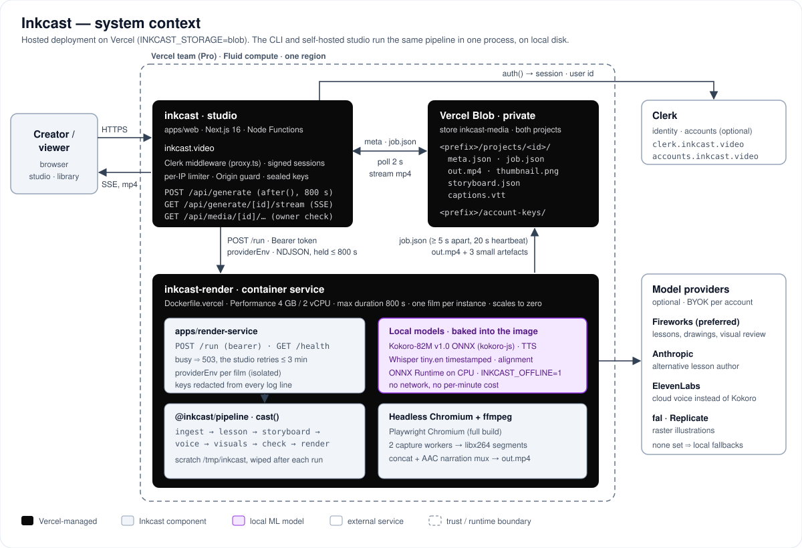
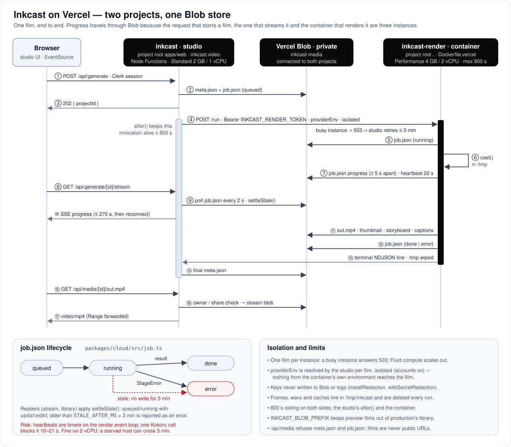
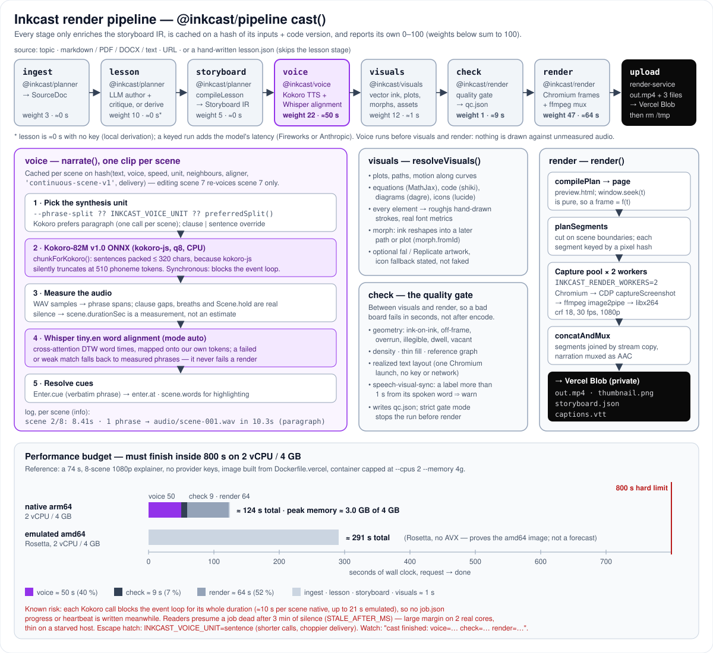

# Inkcast

The preferred cloud path now uses a Fireworks key for lesson authoring, vector diagrams,
edits and visual review, plus local Kokoro speech. The default is
`accounts/fireworks/models/deepseek-v4p1-flash` (catalog checked 2026-10-12).
See [provider setup and data handling](docs/FIREWORKS.md). Raster illustration generation
still uses the optional fal/Replicate adapters; Fireworks retired image/audio inference.


**Say what you want to understand. Get a hand-drawn whiteboard lesson that actually
teaches it.**

```bash
inkcast keys set fireworks          # open-weight planning, diagrams and visual review
inkcast teach "gradient descent"    # -> projects/<id>/out.mp4
```

Inkcast is a **compiler**, not a video model. A topic goes in; a lesson is designed;
that lesson is compiled into a storyboard of curves, drawn ink and moving objects on
one persistent canvas; the storyboard is drawn frame by frame in a headless browser
and muxed with ffmpeg. Everything you see is vector strokes, real text and measured
audio, generated deterministically from an intermediate representation you can read,
edit and diff. No proprietary video model is involved anywhere.

It runs with no API keys at all. That is worth keeping and it is **not** the
recommended way to use it — see [What we claim](#what-we-claim-and-what-we-do-not),
which is the most important section in this file.

---

## Contents

- [Architecture](#architecture)
- [Set up your key first](#set-up-your-key-first)
- [Quickstart](#quickstart)
- [What we claim, and what we do not](#what-we-claim-and-what-we-do-not)
- [The lesson stage: why summarising was the wrong model](#the-lesson-stage-why-summarising-was-the-wrong-model)
- [What the board can draw: plot, path, motion](#what-the-board-can-draw-plot-path-motion)
- [Vertical shorts are a first-class output](#vertical-shorts-are-a-first-class-output)
- [Pipeline internals](#pipeline-internals)
- [The Storyboard IR](#the-storyboard-ir)
- [Editing: the lesson, then the drawing](#editing-the-lesson-then-the-drawing)
- [Cost, honestly](#cost-honestly)
- [Provider matrix](#provider-matrix)
- [CLI reference](#cli-reference)
- [Self-hosting](#self-hosting)
- [Contributing](#contributing)
- [Why AGPL-3.0](#why-agpl-30)

---

## Architecture

Inkcast is one deterministic pipeline with two hosts. The CLI and a self-hosted
studio run it in-process against a `projects/<id>/` directory. The hosted product
(`inkcast.video`) splits it across **two Vercel projects and one private Blob
store**: the studio does auth and bookkeeping, and a container renders one film
per request. This section is the map. The [pipeline internals](#pipeline-internals)
section and [`docs/DEPLOY_VERCEL.md`](docs/DEPLOY_VERCEL.md) have the detail.

| Diagram                                                        | What it shows                                                          |
| -------------------------------------------------------------- | ---------------------------------------------------------------------- |
| [System context](docs/architecture/system-context.svg)         | Actors, Vercel projects, Blob, Clerk, local models, optional providers |
| [Deployment & job lifecycle](docs/architecture/deployment.svg) | One film as a sequence across browser, studio, Blob and container      |
| [Render pipeline](docs/architecture/render-pipeline.svg)       | The seven stages, the voice/check/render internals, measured budget    |
| [Packages](docs/architecture/packages.svg)                     | The pnpm workspace dependency graph                                    |



### Context and goals

- **The video is a pure function of an IR.** A topic or document becomes a `Lesson`,
  then a `Storyboard` (zod, `packages/core`), then frames. Every stage only enriches
  the storyboard, so any film can be read, edited, diffed and re-rendered byte for byte.
- **Zero keys must work.** Local planner, Kokoro voice and built-in figures make a real
  film offline. Keys (Fireworks, Anthropic, ElevenLabs, fal/Replicate) buy quality.
  They are never required.
- **Hosted on managed, scale-to-zero infrastructure.** No database, no queue, no VM.
  State is a handful of Blob objects per film.
- **Hard budget.** A hosted film must finish in **under 800 s on 2 vCPU / 4 GB**.

Non-goals for the hosted path: films longer than the `explainer` preset (≤ 75 s),
edit and re-render (both answer 501, because they need intermediate files that are
deliberately not kept), and queueing with ETAs.

### Components

| Component                  | Code                                                         | Runs on                                                             | Responsibility                                                                                                      | Durable state                       |
| -------------------------- | ------------------------------------------------------------ | ------------------------------------------------------------------- | ------------------------------------------------------------------------------------------------------------------- | ----------------------------------- |
| Studio                     | `apps/web`                                                   | Vercel project `inkcast`, Node Functions (Standard)                 | UI, Clerk/session identity, rate limits, sealing account keys, dispatching films, SSE progress, gating media        | none of its own (Blob)              |
| Render service             | `apps/render-service`                                        | Vercel project `inkcast-render`, container from `Dockerfile.vercel` | `POST /run`: one film per request; runs `cast()`; writes progress and artefacts                                     | none (`/tmp`, wiped per run)        |
| Pipeline + stages          | `packages/pipeline`, `planner`, `voice`, `visuals`, `render` | inside the render container (hosted) or in-process (CLI, self-host) | ingest → lesson → storyboard → voice → visuals → check → render                                                     | project directory                   |
| Cloud adapter              | `packages/cloud`                                             | studio and render service                                           | Blob paths, the `job.json` schema and staleness rule, the `/run` wire protocol. Inert unless `INKCAST_STORAGE=blob` | —                                   |
| Key vault                  | `packages/keyvault`                                          | CLI, studio, render service                                         | BYOK storage (keychain / AES-256-GCM vault), secret redaction for logs and errors                                   | keychain or `~/.inkcast/vault.json` |
| Blob store                 | Vercel Blob, **private**, connected to both projects         | Vercel                                                              | `meta.json`, `job.json`, `out.mp4`, `thumbnail.png`, `storyboard.json`, `captions.vtt`, sealed account keys         | yes                                 |
| Local models               | Kokoro-82M v1.0 ONNX, Whisper `tiny.en` timestamped          | baked into the render image (`INKCAST_OFFLINE=1`)                   | narration and word-level alignment, on CPU                                                                          | weights in `/app/.models`           |
| Identity (optional)        | Clerk                                                        | external                                                            | accounts on `inkcast.video`. Without it, signed anonymous cookies                                                   | external                            |
| Model providers (optional) | Fireworks (preferred), Anthropic, ElevenLabs, fal, Replicate | external                                                            | lesson authoring, drawings and review; cloud voice; raster art                                                      | —                                   |

### One film on Vercel



1. `POST /api/generate` (studio) validates the session and source, writes `meta.json` and
   a `queued` `job.json`, and answers **202** at once.
2. In `after()` (route `maxDuration = 800`) the studio resolves the film's provider
   environment and calls `POST <INKCAST_RENDER_URL>/run` with a bearer token. It holds
   that request open for the whole render. A Vercel container lives only as long as its
   request, so fire-and-forget would let the platform freeze it mid-render.
3. The render service answers `503` if it is already rendering, and the studio retries
   for up to 3 minutes (`BUSY_RETRY_MS`) while Fluid compute adds an instance. Otherwise
   it runs `cast()` in `/tmp` and writes `job.json` on every stage change, at most every
   5 s otherwise, plus a 20 s heartbeat.
4. The browser's `GET /api/generate/[id]/stream` is a different Function instance. It
   polls `job.json` every 2 s and replays it as the same SSE events the in-process job
   registry emits, so client code is identical across hosts.
5. On success the container uploads `out.mp4` plus three small artefacts, marks the job
   `done`, returns a terminal NDJSON line, and deletes its project directory. The studio
   writes the final `meta.json`. If the dispatcher was lost, `store.ts` reconciles the
   record from `job.json` on the next read.
6. `GET /api/media/[id]/out.mp4` checks owner or share status, then streams the private
   blob (Range forwarded). There are no public film URLs.

### The render pipeline in depth



| Stage        | Package            | Does                                                                                    | Writes                                     | Hosted time (ref. film)            |
| ------------ | ------------------ | --------------------------------------------------------------------------------------- | ------------------------------------------ | ---------------------------------- |
| `ingest`     | `@inkcast/planner` | file / URL / text → normalised markdown (`SourceDoc`). Skipped for a bare topic         | `source.json`                              | ≈ 0 s                              |
| `lesson`     | `@inkcast/planner` | decides _what to teach_: LLM author + critique + revision, or a local derivation        | `lesson.json`                              | ≈ 0 s keyless; model latency keyed |
| `storyboard` | `@inkcast/planner` | `compileLesson` → scenes, regions, plots, cues, camera                                  | `storyboard.json`                          | ≈ 0 s                              |
| `voice`      | `@inkcast/voice`   | synthesise, **measure**, align, resolve cues → `scene.durationSec`, `enter.at`, `words` | `audio/scene-NNN.wav` + timing sidecars    | **≈ 50 s**                         |
| `visuals`    | `@inkcast/visuals` | every element → hand-drawn vector strokes, plots, equations, morphs, assets             | visuals sidecar                            | ≈ 1 s                              |
| `check`      | `@inkcast/render`  | the quality gate over the finished board. Strict mode stops here, before any encode     | `qc.json`                                  | **≈ 9 s**                          |
| `render`     | `@inkcast/render`  | Chromium frames → ffmpeg segments → concat + narration mux                              | `out.mp4`, `captions.vtt`, `thumbnail.png` | **≈ 64 s**                         |

**Ordering is load-bearing: voice runs before visuals and render.** Element timing is
resolved against measured audio, never a planner's guess. A diagram that lands two seconds
before the sentence naming it reads as drift even when the audio is sample-accurate.

**Voice** (`packages/voice/src/narrate.ts`), per scene:

- **Unit.** `--phrase-split` ?? `INKCAST_VOICE_UNIT` (`clause` | `sentence` | `paragraph`)
  ?? the provider's `preferredSplit()`. Kokoro prefers `paragraph`, so one call speaks
  the whole scene and keeps sentence-to-sentence prosody. The cache key carries
  `continuous-scene-v1`, the neighbouring scenes' text, the effective unit and the
  delivery settings, so changing any of them re-voices only the affected scenes.
- **Synthesis.** `chunkForKokoro()` packs sentences into chunks of ≤ 320 characters. Without
  it, kokoro-js silently truncates at 510 phoneme tokens: a long sentence comes back as
  audio that stops mid-word. The ONNX call is synchronous on the Node event loop.
- **Measurement.** Phrase spans come from WAV samples. Clause gaps, breaths and
  `Scene.hold` are modelled as real silence, so `scene.durationSec` is measured.
- **Alignment.** Whisper `tiny.en` (transformers.js, cross-attention DTW) gives word times,
  mapped monotonically onto our own tokens. A load failure or weak match falls back to
  phrase timing and never fails a render.
- **Cues.** Each `Enter.cue` (a verbatim narration phrase) resolves to `enter.at`.
  `check` later asserts that labels land within 1 s of their spoken word
  (`speech-visual-sync`).

**Check** (`packages/render/src/check.ts`) runs everything that was already asserted
somewhere, in one place, before the expensive part: storyboard reference graph (including
`morph.fromId`), ink-on-ink, off-frame, overrun, illegible, pen, dwell, vacancy, thin fill,
density, a realized-text sweep (the one check that launches Chromium), and speech/visual
sync. It never calls a model. Repair loops live upstream, where the work is still cheap.

**Render** (`packages/render/src/render.ts`) builds a page whose `window.seek(t)` is pure,
so a frame is a function of `t` alone. The film is cut into segments on scene boundaries.
A pool of `INKCAST_RENDER_WORKERS` (2 on Vercel) Chromium contexts captures frames with
CDP `Page.captureScreenshot` and pipes them into one `libx264` encoder per segment (crf 18,
30 fps). Segments are joined by stream copy and the narration is muxed as AAC. Segments
are keyed by a hash of everything that changes their pixels, so a local re-render re-encodes
only what moved.

### Key design decisions and trade-offs

| Decision                                                                     | Why                                                                                                                                                                        | What it costs                                                                                                                                                                        |
| ---------------------------------------------------------------------------- | -------------------------------------------------------------------------------------------------------------------------------------------------------------------------- | ------------------------------------------------------------------------------------------------------------------------------------------------------------------------------------ |
| **Local Kokoro + Whisper by default**, hosted TTS opt-in                     | $0 per minute; works offline and keyless; deterministic and cacheable per scene; no narration text leaves the box; weights baked into the image, so no cold download       | CPU time (voice is ≈ 40 % of wall clock); a synchronous ONNX call blocks the event loop; prosody below ElevenLabs, which stays one key away                                          |
| **Frames rendered by headless Chromium**, not a video model or a canvas port | Real fonts, text and SVG; MathJax/roughjs reused as-is; deterministic, so segments parallelise and cache; output is inspectable (`preview.html`)                           | Native payload (Chromium + ffmpeg + ONNX) needs a container; render is CPU-bound (≈ 52 % of wall clock); memory caps parallelism at 2 workers on 4 GB                                |
| **Vercel container service** rather than AWS (ECS/Batch/Lambda) or Fly       | One platform and one `git push` for studio and renderer; Blob connects with a click; scales to zero; Fluid compute adds instances under load; no infrastructure to operate | 800 s hard ceiling per request; 4 GB / 2 vCPU maximum size; multi-GB image means cold starts of seconds; no native queue. `docs/DEPLOY.md` keeps the Docker/Fly single-box path open |
| **One held request per film** (`after()` + NDJSON), not a queue or Workflow  | Fewest moving parts that work; a film finishes in one invocation with a wide margin                                                                                        | The studio Function is billed for memory-time while it waits; no mid-film resume (a killed film restarts from scratch); longer formats would need segment fan-out or Vercel Workflow |
| **Progress through `job.json` in Blob**                                      | The starting request, the stream and the renderer are three instances; Blob is the only shared medium; browser code is unchanged                                           | ≈ 44 writes and ≈ 160 reads per film; up to 2 s of extra progress latency; liveness inferred from write recency (see the risk below)                                                 |
| **Private Blob, served only via `/api/media`**                               | Access is decided by the endpoint that serves the file (owner, or share). A public store would mint an unauthenticated URL per film                                        | Every view streams through a Function                                                                                                                                                |
| **Stateless renderer: keep 4 artefacts, discard the rest**                   | Storage ≈ the MP4 (4–15 MB per film); no stale cache can leak between requests on a reused instance                                                                        | No hosted edit or re-render (501); a retry repeats every stage                                                                                                                       |
| **One film per instance**                                                    | A 1080p render peaks at ≈ 3 GB; two would not fit in 4 GB                                                                                                                  | Concurrency equals instances equals cost. There is no admission control beyond the per-IP limiter                                                                                    |

### Performance budget

Ceiling: **800 s** (the container's max duration and the studio's `after()` are both 800 s).
Reference film: 74 s, 8 scenes, 1080p `explainer`, no provider keys, image built from
`Dockerfile.vercel`, container capped with `--cpus 2 --memory 4g`.

| Host                                     | voice  | check | render | total       | peak memory      |
| ---------------------------------------- | ------ | ----- | ------ | ----------- | ---------------- |
| native `linux/arm64`, 2 vCPU / 4 GB      | ≈ 50 s | ≈ 9 s | ≈ 64 s | **≈ 124 s** | **≈ 3.0 GB** / 4 |
| emulated `linux/amd64` (Rosetta, no AVX) | —      | —     | —      | **≈ 291 s** | —                |

- **Headroom.** About 6× under the ceiling natively, and about 2.7× even emulated. Vercel's
  x86 vCPUs are slower per core than Apple silicon, so budget 1.5–2.5× on the CPU-bound
  stages. A keyed lesson adds model latency (logs have recorded ~145 s for a keyed
  lesson), while ElevenLabs removes most of the voice time. See
  [DEPLOY_VERCEL.md → Measured](docs/DEPLOY_VERCEL.md#measured) for the methodology and an
  earlier run on a heavily loaded host.
- **Memory.** About 1 GB of headroom at 2 workers. Do not raise `INKCAST_RENDER_WORKERS` on
  this size. Memory is the first thing a third worker spends.
- **Known risk: event-loop blocking vs. the stale timeout.** Each Kokoro call is a
  synchronous ONNX inference that blocks Node for its whole duration, measured at
  10–21 s per scene call (the upper end on the emulated image). Progress writes and the 20 s
  heartbeat are timers on that same loop, so **no `job.json` write happens during a call**.
  Readers presume a job dead after `STALE_AFTER_MS = 3 min` of silence
  (`packages/cloud/src/job.ts`). That leaves a wide margin on two real cores and a thin one
  on a host starved far below that. Mitigations, in order of preference: run synthesis
  in a `worker_thread` so the heartbeat keeps ticking (not yet implemented); set
  `INKCAST_VOICE_UNIT=sentence` (shorter calls, choppier delivery); and watch the
  per-scene `in Xs` lines.

### Failure modes

| Failure                                       | Detected by                                     | What the user sees                                  | Recovery                                                            |
| --------------------------------------------- | ----------------------------------------------- | --------------------------------------------------- | ------------------------------------------------------------------- |
| Every render instance reached is busy         | `503` from `/run` → `RenderServiceBusy`         | "Starting a renderer…" queue message                | Studio retries for ≤ 3 min, then fails the job                      |
| Render killed (800 s, OOM, deploy, `SIGTERM`) | no `job.json` write for 3 min → `settleStale()` | error naming the last stage                         | Start again; hosted runs keep no stage cache                        |
| Studio dispatcher dies mid-run                | the render request is cut off                   | progress continues while the container writes       | `store.ts` reconciles `meta.json` from `job.json` on read           |
| A stage throws                                | `StageError` carrying `stage` and `cause`       | error with the stage name and root cause            | Fix the input or key and rerun; locally, finished stages are cached |
| Board fails the gate (`strict`)               | `check` → `qc.json`                             | error before any frame is drawn                     | Edit the lesson or storyboard and rerun                             |
| Provider key missing or rejected              | provider resolution / validation                | degradation stated (`degrade.ts`) or a strict block | Local fallback (Kokoro, derived lesson, icons) or fix the key       |
| Whisper cannot load or match                  | aligner match fraction                          | nothing (phrase-level timing)                       | Automatic fallback; never fails a render                            |
| SSE stream reaches 270 s                      | stream closes by design                         | nothing                                             | `EventSource` reconnects and the current state is replayed          |

### Security

- **Identity.** Clerk via `apps/web/proxy.ts` when configured. Otherwise a signed
  anonymous cookie (`INKCAST_SESSION_SECRET`). See [`docs/AUTH.md`](docs/AUTH.md).
- **Abuse controls.** Mutating routes check `Origin` against `INKCAST_PUBLIC_URL`.
  `INKCAST_HOSTED=1` adds a per-IP limiter (held in memory per instance, so it is
  looser than configured), a 20k-character source cap and the `explainer` preset only.
- **Studio → renderer.** The bearer token (≥ 24 chars) is compared in constant time
  over SHA-256 digests. The body is ≤ 1 MB and zod-validated. An optional
  `x-vercel-protection-bypass` handles protected deployments.
- **Keys and isolated jobs.** With accounts on, each account's keys are sealed (AES-256-GCM
  under `INKCAST_SECRET_KEY`) in private Blob. The studio resolves a per-film
  `providerEnv`. With `isolated: true` the renderer uses exactly that, so no key
  configured on the render project can reach an account's film. Provider keys are stripped
  from the container's own environment, redacted from logs and errors
  (`installRedaction`, `withSecretRedaction`), and never written to Blob.
- **Data.** The Blob store is private. `/api/media` enforces owner or share access and
  refuses `meta.json` and `job.json`. An uploaded source must be this project's own blob
  path, and repository paths are confined to the image checkout.
- **Sandbox.** Chromium runs without its sandbox inside the container. The instance is the
  isolation boundary: one film per instance, and `/tmp` is wiped after each run.

### Observability

| Signal                   | Where                          | Example / content                                                                                               |
| ------------------------ | ------------------------------ | --------------------------------------------------------------------------------------------------------------- |
| Per-film stage timings   | `inkcast-render` runtime logs  | `[render-service] <id> cast finished: ingest=…s lesson=…s storyboard=…s voice=…s visuals=…s check=…s render=…s` |
| Per-scene synthesis time | `inkcast-render` logs, `info`  | `scene 2/8: 8.41s · 1 phrase → audio/scene-001.wav in 10.3s (paragraph)`                                        |
| Live progress            | `job.json` → SSE → studio UI   | `stage`, overall `pct` (weighted: render 47, voice 22, visuals 12, …), `stagePct`, `note`                       |
| Liveness                 | `GET /health` on both projects | `{"ok":true,"service":"inkcast-render","busy":false}`; studio reports Blob + renderer config                    |
| Quality verdict          | `qc.json` (local projects)     | every check, its tier and its findings                                                                          |
| Run record               | `pipeline.json` (local)        | timings, providers, cost estimate                                                                               |

The gap is metrics: there are no counters or traces yet. Grepping `cast finished:` is the
current SLO instrument. A log drain or Vercel custom metrics on stage seconds would be the
next step.

### Running locally vs. deploying

| Mode                         | How                                                                                      | State                                | Pipeline runs                   |
| ---------------------------- | ---------------------------------------------------------------------------------------- | ------------------------------------ | ------------------------------- |
| CLI                          | `inkcast teach "<topic>"`, `cast <file\|url\|lesson.json>`                               | `projects/<id>/`                     | in-process                      |
| Local studio                 | `pnpm dev` → `localhost:3000`                                                            | `projects/` + in-memory job registry | in the Next.js server process   |
| Single box (Docker, Fly, VM) | [`docs/DEPLOY.md`](docs/DEPLOY.md)                                                       | a volume                             | in the studio process           |
| Render container, locally    | `docker buildx build -f Dockerfile.vercel …`, `docker run --cpus 2 --memory 4g …`        | Blob (real or emulated)              | container, one film per request |
| Vercel (`inkcast.video`)     | [`docs/DEPLOY_VERCEL.md`](docs/DEPLOY_VERCEL.md): two projects, one Blob store, env vars | private Blob                         | `inkcast-render` container      |

Everything Vercel-specific is behind `INKCAST_STORAGE=blob`. Without it, the studio,
the CLI and Docker behave exactly as before.

---

## Set up your key first

This is step one, before the quickstart, because it is the difference between a
video that teaches and a video that recites.

```bash
inkcast keys set fireworks        # prompted, hidden, never echoed or logged
inkcast keys list                 # masked previews and where each key lives
inkcast keys validate             # one cheap live call per configured provider
inkcast keys delete fireworks     # forget it
```

Keys are stored in your **macOS keychain**, or in an AES-256-GCM vault file
(`~/.inkcast/vault.json`, `0600`) on other platforms. The CLI and the studio share
one store, so you set a key once. An exported provider variable (for example `FIREWORKS_API_KEY`) wins over its
stored key — `inkcast keys list` tells you which is winning, because a shadowed
credential you cannot see is worse than no credential.

Bring your own key: Inkcast has no account, no proxy and no telemetry. Each key is sent only to its corresponding provider. Source material is sent to
the selected cloud model when cloud generation is enabled; rendering stays local.
See [Fireworks setup and data handling](docs/FIREWORKS.md) for the open-weight path.

Two other keys are optional upgrades: `elevenlabs` for a publishable narrator, and
`replicate` or `fal` for illustrated objects and characters. Neither changes whether
the lesson is any good.

---

## Quickstart

**Requirements:** Node 22+, pnpm 10+, and `ffmpeg` on your `PATH`
(`brew install ffmpeg` / `apt install ffmpeg`). Chromium is fetched by Playwright.

```bash
pnpm install
pnpm exec playwright install chromium     # ~150 MB, once per machine
inkcast keys set anthropic                # see above
inkcast teach "gradient descent"          # -> projects/<id>/out.mp4
pnpm dev                                  # the studio, at localhost:3000
```

The first run also downloads the local text-to-speech weights (Kokoro-82M, ~92 MB,
cached and shared across projects).

```bash
# a 45-second vertical short, one idea, one visual, one payoff
inkcast teach "why neural nets need a non-linearity" --short --depth quick

# teach from material you already have
cast ./docs/architecture.md --depth deep
cast https://en.wikipedia.org/wiki/Backpropagation --short

# read the lesson before you trust the video, then edit it and re-run
inkcast lesson last

# render a hand-authored lesson: no model, no key, fully deterministic
cast examples/lessons/gradient-descent.lesson.json
```

Check what your machine will actually do, and what it is giving up:

```bash
inkcast providers
```

```
STAGE       PROVIDER              WHERE  WHY
lesson      anthropic/claude-…    cloud  ANTHROPIC_API_KEY is set
storyboard  local compiler        local  plots, ink, regions and camera are computation
voice       kokoro/af_heart       local  ELEVENLABS_API_KEY is unset
visuals     builtin               local  no image provider key set
render      playwright + ffmpeg   local  ffmpeg found: ffmpeg version 8.1.2
```

---

## What we claim, and what we do not

The first version of this README headlined **$0.00 per minute** while shipping
something that taught nothing. Optimising for the free provider was the wrong
variable, and we are not going to make that mistake twice. So, plainly:

**With a Fireworks or Anthropic key**, the selected model writes the lesson: a hook that is a concrete
question rather than a definition, an everyday anchor the abstraction maps onto, one
new idea per beat with a reason instead of an assertion, a worked example with real
numbers, and the specific misconception a learner forms — then the plan has to
survive a structural critique, and problems are fed back for a revision pass before
anything is drawn. This is the product. It costs a few cents per video.

**With no key**, the lesson is _derived_ from the structure of what you gave it. It
is real, it renders, and it is much weaker: it can only reorganise what the source
already says. No invented anchor, no worked example, no named misconception. On a
bare topic with no document it has almost nothing to work from. The CLI says so
before it starts, and tells you the one command that fixes it:

```
degraded lesson — no cloud planner key. the lesson is derived from structure rather than
         taught from first principles — no invented anchor, no worked example, no
         named misconception. This is the biggest single quality difference in Inkcast.
         fix: inkcast keys set fireworks
```

The zero-key path exists so the renderer can be tested, so a contributor can work
without spending money, and so nothing about Inkcast is gated behind a payment. It
is a floor, not the ceiling.

**Also honest about the gaps**, because "teaches literally any concept" would be a
lie today:

- Maths, CS, ML, physics, economics and statistics are well served: they are mostly
  curves, and curves are what the IR is now best at.
- Narrative subjects — the Odyssey, the French Revolution — need drawn characters
  who stay the same person across poses. The IR can represent them and cache them by
  id, but identity across poses is not solved, needs an image key, and has no
  zero-key fallback worth the name. See `docs/LESSON-ENGINE.md`.
- The honest quality bar we hold ourselves to is one question, and it is in that
  document: after watching the gradient-descent video, can a learner who does not
  know calculus explain why the update has a minus sign?

---

## The lesson stage: why summarising was the wrong model

The MVP went straight from document to storyboard. That made the planner a
**summariser**: it chopped prose into beats and read them aloud. Summarising and
teaching are different algorithms, and no amount of visual polish rescues a video
that never builds an idea. A learner watched our gradient-descent output and learned
nothing.

So there is now a stage whose only job is deciding what to teach, and it runs before
anything is drawn:

```
ingest → lesson → storyboard → voice → visuals → render
```

A `Lesson` (`packages/core/src/lesson.ts`) is deliberately **not** a document
outline. Its shape is the pedagogy:

| Field           | What it is                                                                                                                                      |
| --------------- | ----------------------------------------------------------------------------------------------------------------------------------------------- |
| `objective`     | What the learner must be able to _do_ afterwards. The acceptance test.                                                                          |
| `hook`          | A concrete question or surprise in the first five seconds. Never a definition, never "in this video we will".                                   |
| `anchor`        | An everyday situation the learner already understands — hiking downhill in fog — that every later abstraction maps back onto.                   |
| `steps[]`       | One new idea each, ordered so nothing forward-references. Each carries the idea, **why it must be true**, and the visual that makes it obvious. |
| `worked`        | A walkthrough with real numbers. Where understanding consolidates.                                                                              |
| `misconception` | The specific wrong belief formed here, named and refuted. For gradient descent: that it finds _the_ minimum.                                    |
| `recap`         | The chain retraced against the finished board.                                                                                                  |
| `jargonBudget`  | Terms that must be earned before they are used.                                                                                                 |

`critiqueLesson()` rejects the predictable failures — a beat that asserts without
justifying, a hook that opens with a preamble, jargon used before it is earned, a
beat with nothing to look at, a plan that overruns its target. With a key, the
critique is fed back for one revision pass; either way the problems are printed
rather than hidden.

**The lesson is an artefact you own.** It is written to `projects/<id>/lesson.json`.

```bash
inkcast lesson last          # print it: every beat, its reason, its visual, the critique
$EDITOR projects/<id>/lesson.json
inkcast teach "gradient descent" --project <id>   # your edits survive; the board rebuilds
```

Re-running keeps your edited lesson (its cache key is unchanged), recompiles the
board because the storyboard's key follows the lesson's _content_, re-voices only
the beats whose words changed, and re-renders. Editing the storyboard changes the
drawing; editing the lesson changes the teaching, which is usually what you meant.

`examples/lessons/*.lesson.json` are hand-authored lessons. `cast
some.lesson.json` renders one with no planner, no model and no key — useful as a
fixture, and as a demonstration of the ceiling.

---

## What the board can draw: plot, path, motion

The old vocabulary was text, icons, rectangles, arrows and box-and-line diagrams. It
could not express a curve, a tangent, a bowl, or anything moving — which is why
every "explain a concept" video collapsed into captions in boxes. The planner was
never the binding constraint; the vocabulary was.

Three additions do most of the work, and all three are **local, free and
deterministic**:

- **`plot`** — a cartesian frame with hand-drawn axes, curves (explicit samples or a
  named function: `parabola`, `sigmoid`, `gaussian`, `doubleWell`, `exp`, `log`, …)
  and overlays that serve an argument rather than decorate it: a marked `point`, a
  `tangent` at x (this is how you show slope, and therefore the whole intuition
  behind a gradient), a `dropline` for reading a value off an axis, `shade` between
  curves, `steps` for a descent, and `annotate` with a leader line. Gradient
  descent, learning rate, overfitting, compound interest and supply/demand are each
  _one_ `plot`.
- **`path`** — a freeform hand-drawn stroke from points or SVG path data, roughened
  to match the ink. The escape hatch for whatever the vocabulary lacks: a hillside,
  a bowl, a container, a brace, a squiggle.
- **`motion`** — any element moving along a path over a time window, with easing and
  an optional dotted trail. The ball descending the loss curve teaches more than any
  caption about it, and before this nothing on the board could move.

Named functions exist so the planner can ask for "a bowl" without emitting a hundred
coordinates — and so there is never an expression evaluator in the pipeline: no
`eval`, no injection surface, identical output every run.

`illustration` assets (drawn objects and characters, resolved through
text-to-image → vectorise → roughen, cached by id so a reused entity is
pixel-identical) need an image key. Without one, that lane falls back to the
built-in icon set and says so.

Two older properties still hold and are the reason the board reads as an argument
rather than a slideshow:

- **One persistent canvas.** Elements default to `persist: true`, scenes move a
  _camera_ over one large board, and consecutive beats share a `region` so the
  camera frames the growing union of what has been drawn. The accumulated board at
  the end _is_ the summary — that is the entire reason to use a whiteboard instead
  of slides.
- **Silence is modelled.** `Scene.hold` is real silence rendered into the clip, so a
  beat can land before the next idea arrives and a question can hang long enough for
  the learner to attempt an answer. Narration is paced for teaching (140–160 wpm),
  and beats never split a sentence.

---

## Vertical shorts are a first-class output

`--short` is not a cropped 16:9 video. Short-form vertical is the highest-leverage
way to distribute teaching, and the constraint improves the product: 45–60 seconds
forces one idea, one visual, one payoff.

```bash
inkcast teach "why the sky is blue" --short --depth quick --out shorts/
```

The `short` preset changes the _lesson_, not just the frame: fewer beats survive,
each may speak fewer words (trimmed only ever at a sentence boundary — the MVP cut
mid-sentence and produced fragments like "under you gets gentler"), each beat draws
exactly one visual, type is larger, and the camera walks down a tall canvas rather
than panning across a wide one. `--depth quick|standard|deep` scales the runtime
target on top of that, and `--seconds <n>` sets a hard one for platforms that cut
you off.

---

## Pipeline internals

```
              ┌────────┐  SourceDoc  ┌────────┐  Lesson  ┌────────────┐
  topic ─────►│        │ ──────────► │        │ ───────► │            │
  file  ─────►│ ingest │             │ lesson │          │ storyboard │
  URL   ─────►│        │             │        │          │            │
  lesson.json─┴────────┘             └────────┘          └────────────┘
              @inkcast/planner       Claude, or a         one scene per beat:
              (skipped for a         local derivation     plots, ink, regions,
               bare topic)           + critique + revise  cues, camera
                                                                │
                                                     Storyboard │
                                                                ▼
   ┌────────┐            ┌─────────┐                       ┌────────┐
   │ render │ ◄───────── │ visuals │ ◄──────────────────────┤ voice  │
   └────────┘  + strokes └─────────┘  + durationSec         └────────┘
   @inkcast/render       @inkcast/visuals   + resolved cues  @inkcast/voice
   Playwright frames     plots, paths, ink, icons,           Kokoro locally,
   + ffmpeg mux          or a text-to-image model            or ElevenLabs
```

**Voice runs before visuals and render, and that ordering is load-bearing.** The
voice stage synthesises narration in phrases, measures the real audio into
`scene.durationSec`, and resolves every `Enter.cue` — a verbatim phrase of the
narration — into the fraction of the scene where those words are actually spoken.
The MVP was sample-accurate at the _beat_ level and still felt misaligned, because
element timing was a fraction the planner guessed; a diagram arriving two seconds
before the sentence that names it is experienced as drift. Nothing may be drawn or
rendered against unresolved timing.

Every stage **only enriches the storyboard**. That single property buys three
things:

- **Resumability.** Artefacts are saved after every stage and each stage's inputs are
  hashed into `cache.json`. Crash during render and you re-render; everything before
  it is already done. Cast the same thing twice and the second run does nothing.
  Cache keys include a **code version** for the pipeline and for each stage, because
  hashing only the inputs meant a shipped fix kept serving the old artefact and
  looked like it had not worked. That bug cost us a day; it cannot recur.
- **Editability.** An edit is a patch to JSON — to the lesson for teaching, to the
  storyboard for drawing — and a re-render is a pure function of it.
- **Progress you can trust.** Stages report their own 0–100; the pipeline squashes
  them into one monotonic number weighted by real wall-clock share (render is 48% of
  it, the lesson stage 10%), which is what the CLI bar and the studio's SSE stream
  both display.

```
packages/core        the Storyboard IR, the Lesson IR + critique, logging, cache
packages/planner     ingest + teachLesson + compileLesson
packages/keyvault    BYOK credential storage, shared by the CLI and the studio
packages/voice       narrate — synthesis, measurement, cue resolution
packages/visuals     resolveVisuals — plots, paths, ink, motion, assets
packages/render      render — Playwright + ffmpeg
packages/pipeline    the orchestrator: teach / cast / designLesson / rerender
apps/cli             inkcast / cast
apps/web             the studio (Next.js)
examples/            source documents, hand-authored lessons, a hand-written storyboard
projects/<id>/       one directory per video (gitignored)
```

A project directory is the whole state of a video — no database:

```
projects/8f2ac1d0b3e4/
├── lesson.json        what it teaches. Edit this one.
├── storyboard.json    the IR, after the last stage that touched it
├── source.json        the ingested document (absent for a bare topic)
├── audio/scene-*.wav  one clip per scene, plus measured phrase timings
├── frames/            transient capture space
├── preview.html       the deterministic page the frames came from
├── cache.json         input + code-version hashes per stage
├── pipeline.json      title, timings, cost, provider choices, lesson summary
└── out.mp4            the video
```

Copy that directory to another machine and it still renders. `inkcast list` rebuilds
the library from disk on every call, so a finished video cannot be lost.

Programmatic use:

```ts
import { teach, cast, designLesson, rerender } from '@inkcast/pipeline';

// The normal case.
const { videoPath, lesson, problems } = await teach('gradient descent', {
  objective: 'explain why the update has a minus sign',
  preset: 'short',
  onProgress: (p) => console.log(p.stage, `${p.pct}%`, p.note ?? ''),
});

// Review the teaching before paying for a render (one model call, no frames).
const design = await designLesson({ filePath: 'paper.pdf', depth: 'deep' });

// A hand-authored lesson: no planner, no key.
await cast({ lesson: 'examples/lessons/gradient-descent.lesson.json' });

await rerender(design.projectId);
```

---

## The Storyboard IR

`packages/core/src/storyboard.ts` is the one contract every stage agrees on. It is a
zod schema, so it validates at every boundary.

```jsonc
{
  "version": 1,
  "title": "Gradient descent",
  "meta": { "aspect": "9:16", "style": "marker", "voice": "af_heart", "fps": 30 },
  "canvas": { "x": 0, "y": 0, "w": 1080, "h": 3600 }, // ONE board; the camera tours it
  "assets": [],
  "scenes": [
    {
      "id": "beat-003",
      "role": "step", // the pedagogical job this beat does
      "region": "slope", // consecutive beats share a region, so the board accumulates
      "narration": "Lay a straight edge against the curve where you are standing.",
      "hold": 0.8, // real silence after the words, so the idea lands
      "camera": { "x": 540, "y": 1400, "zoom": 1.4, "transition": 0.9 },
      "elements": [
        {
          "id": "loss",
          "type": "plot",
          "at": { "x": 80, "y": 1150, "w": 920, "h": 620 },
          "xDomain": [-4, 4],
          "yDomain": [0, 16],
          "xLabel": "one dial",
          "yLabel": "how wrong we are",
          "curves": [{ "id": "bowl", "fn": { "name": "parabola", "params": [1] } }],
          "overlays": [
            { "kind": "point", "curveId": "bowl", "x": 3, "at": 0.1 },
            { "kind": "tangent", "curveId": "bowl", "x": 3, "span": 1.5, "at": 0.55 },
          ],
          "enter": { "cue": "straight edge", "style": "draw" }, // resolved by the voice stage
        },
      ],
    },
  ],
}
```

| Concept       | What it is                                                       | Why it is shaped that way                                                 |
| ------------- | ---------------------------------------------------------------- | ------------------------------------------------------------------------- |
| `canvas`      | One coordinate space for the whole video                         | Scenes tour it with a camera instead of clearing it                       |
| `region`      | Which patch of board a beat draws into                           | Consecutive beats share one, so the camera frames a growing union         |
| `role`        | hook / anchor / step / worked / misconception / recap            | The lesson's structure survives into the drawing                          |
| `hold`        | Seconds of deliberate silence after the narration                | A breath before the next idea; otherwise every gap is unintended dead air |
| `elements`    | text, asset, shape, arrow, diagram, emphasis, **plot**, **path** | `emphasis` targets an element drawn earlier by id                         |
| `motion`      | Optional on any element: waypoints, window, easing, trail        | Movement is most of what makes an explanation legible                     |
| `persist`     | Defaults to `true`                                               | The board accumulates; that is the whole point                            |
| `enter.cue`   | A verbatim phrase of this beat's narration                       | The element lands on the words that introduce it                          |
| `enter.at`    | Fraction of the scene, 0–1; the fallback when a cue is absent    | Survives re-voicing in another language or voice                          |
| `assets[]`    | Entity library, `id` + `seed`                                    | One entity, one look, forever                                             |
| `durationSec` | Written by the voice stage                                       | Measured, never estimated                                                 |

`examples/storyboard-handwritten.json` is a complete storyboard written by hand —
the fastest way to exercise voice, visuals and render with no planner in the loop:

```bash
mkdir -p projects/handwritten
cp examples/storyboard-handwritten.json projects/handwritten/storyboard.json
inkcast rerender handwritten && inkcast preview handwritten
```

---

## Editing: the lesson, then the drawing

Two levels, and picking the right one saves you a fight:

```bash
# the teaching — edit projects/<id>/lesson.json, then re-cast
inkcast lesson last
inkcast teach "gradient descent" --project <id>

# the drawing — plain-English patches to the storyboard
inkcast edit last "scene 3 narration: slow down and give a concrete example"
inkcast edit last "make it vertical; use pencil; voice: am_puck"
inkcast rerender last
```

With a key, Claude maps free-form instructions onto a small list of typed edit
operations. **With no key, editing still works**: instructions are matched locally
against documented patterns (title, narration, insert / delete / move scene, zoom,
voice, language, style, palette, aspect, fps, outro, pacing, element text). Either
path ends in the same deterministic applier with the zod schema as its gate, and
`inkcast edit` prints the patterns it understands if it cannot parse yours.

Editing narration clears that scene's measured audio; changing the voice or language
clears all of it — so the cache can never serve a duration belonging to a clip you
no longer have.

---

## Cost, honestly

Quality first, price second — that ordering is the correction. What a run costs:

| Stage      | Local default                         | Cloud upgrade                  | Published list price       |
| ---------- | ------------------------------------- | ------------------------------ | -------------------------- |
| lesson     | derived from structure (much weaker)  | `claude-opus-5`                | ~$0.03–0.15 per video      |
| storyboard | the compiler — always local           | —                              | —                          |
| voice      | Kokoro-82M via `kokoro-js`            | ElevenLabs, Creator tier       | ~$0.19 per finished minute |
| visuals    | built-in icons + procedural plots/ink | FLUX-class on Replicate / fal  | ~$0.003 per image          |
| render     | Playwright + ffmpeg, your CPU         | — (there is no cloud renderer) | —                          |

The open-weight configuration uses **Fireworks for model calls and Kokoro for local speech**.
See [the current model and measured-cost policy](docs/FIREWORKS.md); paid retries and
drawing review count toward the video cost. Adding a cloud
voice puts you in the region of **$0.20 per finished minute**, which is where the
per-minute figure actually comes from. A fully local run costs exactly $0.00 and is
the weakest output Inkcast produces; that is a floor for development and CI, not a
recommendation.

The CLI prints the arithmetic after every run:

```
  cost       ~$0.06 (estimated · lesson anthropic/claude-opus-5 $0.0612 · $0.041/min)
  cost       $0.00 — nothing left this machine
```

Cloud figures are **estimates from observed quantities** (characters sent, lesson
JSON produced, characters spoken, images generated) times published list prices —
not an invoice. A supplied lesson is never charged for, even with a key set, because
the model never ran.

For context, commercial whiteboard-video tools publish $1.25–$8.00 per finished
minute (Golpo AI: $2.00, from its own API pricing, researched 2026-07-28 — see
`docs/research/golpo-ux.md`). Those are their list prices, not our measurements, and
volume bundles beat them. The point is not the multiple: it is that subscription
tiers _gate capability_ — colour, length, script editing, voice cloning, frame edits
each behind a different price point. Inkcast has no tiers.

---

## Provider matrix

| Stage      | Runs local & free                                            | Key                  | What the key buys                                                                         | Missing key behaviour                           |
| ---------- | ------------------------------------------------------------ | -------------------- | ----------------------------------------------------------------------------------------- | ----------------------------------------------- |
| ingest     | ✅ always                                                    | —                    | —                                                                                         | —                                               |
| lesson     | ⚠️ derived from structure                                    | `fireworks` or `anthropic` | **The teaching itself**: anchor, derivation, worked example, misconception, revision pass | Derived lesson, and the CLI names the cost      |
| storyboard | ✅ always — plots, ink, regions, cues, camera                | —                    | —                                                                                         | —                                               |
| voice      | ✅ Kokoro-82M (28 voices; macOS `say` only as a build check) | `elevenlabs`         | More natural prosody, more languages, cloning                                             | Kokoro, which is genuinely listenable           |
| visuals    | ✅ plots, paths, procedural diagrams, built-in icons         | `replicate` or `fal` | Illustrated objects and characters                                                        | Icon fallback, stated plainly rather than faked |
| render     | ✅ Playwright + ffmpeg                                       | —                    | —                                                                                         | —                                               |

Set keys with `inkcast keys set <provider>`, or export the environment variable
(`FIREWORKS_API_KEY`, `ANTHROPIC_API_KEY`, `ELEVENLABS_API_KEY`, `REPLICATE_API_TOKEN`, `FAL_KEY`) — see
[`.env.example`](.env.example). Rules the whole project keeps: **local is always
available**, a cloud provider is used only when its key is present, a missing or
rejected key produces a diagnostic naming the fix. In strict mode, a failed cloud
lesson blocks before narration instead of publishing heuristic fallback content.

The one caveat to "works offline": the local voice needs a one-time ~92 MB model
download. If it fails, the voice stage says so and falls back rather than failing.

---

## CLI reference

```
inkcast teach <topic> [options]        design a lesson and render it
cast <file|url|topic|lesson.json|->    same pipeline, from material you have
inkcast lesson <id>                    print what a project teaches, and how to edit it
inkcast keys [list|set|validate|delete] manage API keys (shared with the studio)
inkcast list                           list projects on disk
inkcast open <id>                      open a project's video
inkcast edit <id> "<instruction>"      patch the storyboard in plain English
inkcast rerender <id>                  rebuild the video from the storyboard
inkcast preview <id> [--port 4321]     serve a preview page on localhost
inkcast providers                      what each stage will use, and what it gives up
```

Lesson options: `--depth quick|standard|deep`, `--objective`, `--audience`,
`--brief`, `--seconds <n>`, `--lesson <path>`.
Format options: `--short`, `--aspect 16:9|9:16|1:1`, `--preset standard|short|square`,
`--title`, `--voice`, `--lang`, `--style <id>` (the ids in `styles/`: `marker`,
`pencil`, `chalk`, `ink`, plus any you add), `--palette mono|color`.
Run options: `--out`, `--project`, `--force`, `--open`, `--json`, `--verbose`,
`--quiet`, `--via lesson|document`.

`<id>` accepts a unique prefix or `last`. Progress is a live bar on a TTY and plain
per-stage lines when piped. Exit codes: **0** success, **1** handled failure, **2**
bad usage. `--json` prints one machine-readable object and nothing else, which is
the supported way to script Inkcast.

`--via document` skips the lesson stage and summarises the source instead. It is the
renderer's zero-key test fixture, kept because the frame compiler needs something
stable to be tested against. It is not a route to a video worth watching, and the
CLI labels its output accordingly.

Failures name the stage that broke, keep the original cause, and suggest the fix:

```
✗ render stage failed
  ffmpeg exited with code 1
  → Install ffmpeg (macOS: `brew install ffmpeg`, Debian: `apt install ffmpeg`)
  Nothing is lost: re-run the same command to resume project f7e2cc6cc59d.
```

---

## Self-hosting

Inkcast is local-first, so "self-hosting" is just running it somewhere else. No
database, no queue, no object store — a project is a directory.
(The hosted Vercel topology, which does use an object store, is in
[Architecture](#architecture) and [`docs/DEPLOY_VERCEL.md`](docs/DEPLOY_VERCEL.md).)

```bash
git clone <your fork> && cd inkcast
pnpm install
pnpm exec playwright install --with-deps chromium   # --with-deps on Linux
pnpm build
pnpm --filter @inkcast/web build
pnpm --filter @inkcast/web start                    # put your proxy in front of it
```

Notes for a real deployment:

- **Keys.** On a headless box the keyvault uses its encrypted file backend and needs
  `INKCAST_VAULT_PASSPHRASE` (or `INKCAST_VAULT_PASSPHRASE_FILE`); exporting
  `ANTHROPIC_API_KEY` directly also works and takes precedence. Keys stay
  server-side: nothing in the pipeline needs one in the browser.
- **Disk, not CPU, is the surprise.** Frames are transient but audio, artwork and
  mp4s accumulate under `projects/`. Point `INKCAST_PROJECTS` at a volume you can
  grow, and prune with `rm -rf`.
- **Rendering is CPU-bound.** `INKCAST_RENDER_WORKERS` trades RAM for wall-clock;
  each worker is a Chromium page.
- **Any gate must be enforced by the endpoint that serves the file**, never by
  hiding a button.
- **The AGPL applies to network use.** If you offer a modified Inkcast to users over
  a network, publish your modifications.

---

## Contributing

Contributions are welcome, and the bar is concrete rather than ceremonial.

1. **Read [`docs/CONTRACT.md`](docs/CONTRACT.md) and
   [`docs/LESSON-ENGINE.md`](docs/LESSON-ENGINE.md) first.** The first is the build
   contract: package boundaries, stage signatures, the rules that keep parallel work
   from colliding. The second is the diagnosis of why the MVP taught nothing and the
   plan that follows from it. Both are binding.
2. **The Storyboard IR and the Lesson IR are the contracts.** Do not reshape them.
   New fields are `.optional()` and must come with a reason.
3. **Judge changes by whether a learner understands afterwards**, not by whether the
   output looks busier. The benchmark is in `docs/LESSON-ENGINE.md`.
4. **The zero-key path must keep working** — and must keep saying that it is the
   lesser path. Every feature needs a local default; cloud providers are opt-in
   adapters; a missing key degrades with a clear line naming the fix, never a crash.
5. **No placeholders.** No `TODO: implement`, no function that throws "not
   implemented", no mock data standing in for logic.
6. **Before opening a PR:** `pnpm typecheck`, `pnpm lint`, and the tests for the
   packages you touched (`pnpm --filter @inkcast/pipeline test`). New provider
   adapters should state, in the PR, what happens when the key is absent.
7. **Renderer stays Playwright + ffmpeg.** Remotion is deliberately excluded — it
   requires a paid company licence above three employees, which is incompatible with
   what this project is for.

Good first contributions: a hand-authored lesson in `examples/lessons/` for a topic
you know well (no key needed, and the most useful thing you can add), a new named
curve function, **an ink style — a JSON file in `styles/` and no TypeScript at all**,
another local voice engine, a document format for `ingest`, or better `--json` output
for scripting.

---

## Why AGPL-3.0

Inkcast exists because this category is priced as if generating a whiteboard video
were expensive. It is not — it is a compiler, and compilers should be free. The
[AGPL-3.0](LICENSE) is what keeps it that way:

- **Improvements come back.** Anyone may use, study, modify and redistribute
  Inkcast. If they distribute it, or **run a modified version as a network
  service**, they publish their changes under the same licence. The plain GPL leaves
  that hosting loophole open; the AGPL closes it.
- **You are not restricted as a user.** Run it on your laptop, run it inside your
  company, teach a thousand internal training videos — the AGPL asks nothing of you
  until you distribute the software or offer it to others as a service.
- **Your videos are yours.** The licence covers this software, not its output.
  Inkcast makes no claim on the mp4s you produce or the documents you feed it.
- **Your keys are yours.** Bring your own key, stored in your own keychain. There is
  no Inkcast account, no proxy in front of the model, and no telemetry.

Copyright the Inkcast contributors. Licensed under the GNU Affero General Public
License v3.0 — the full text is in [`LICENSE`](LICENSE). Third-party components keep
their own licences, including Kokoro (Apache-2.0), Lucide icons (ISC) and rough.js
(MIT).
