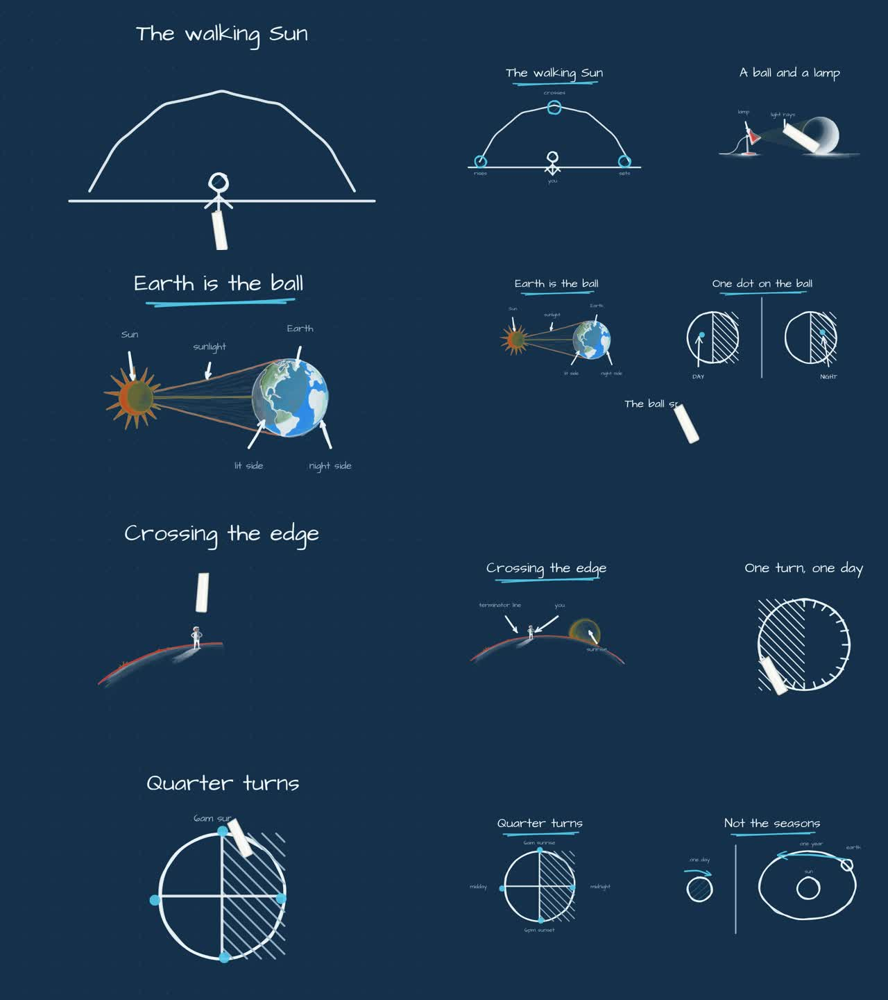
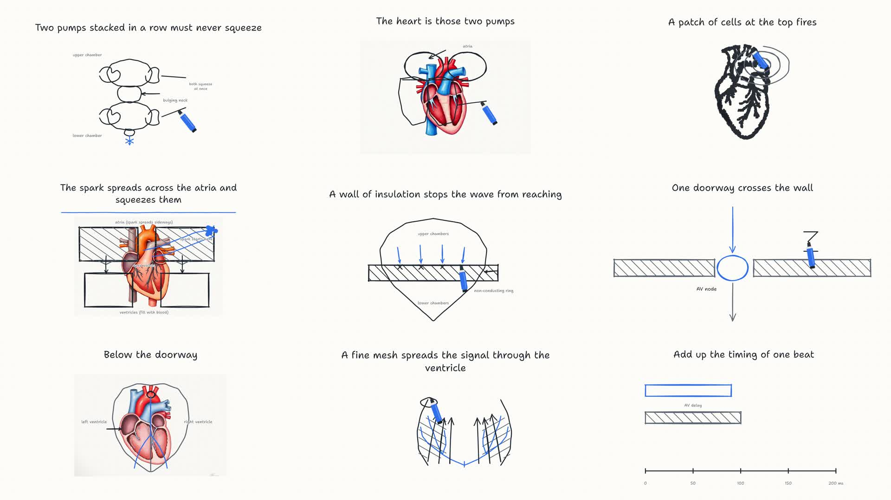
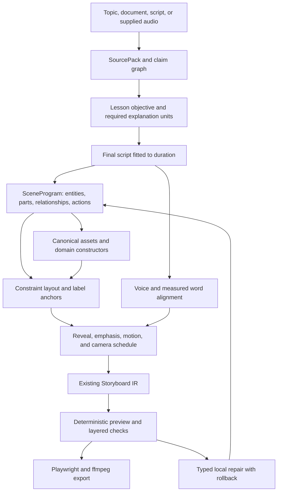

# Inkcast: engineering investigation and plan for Golpo parity

**Date:** 2026-10-12  
**Audited revision:** `24f2a6a53cd5dfe26ef9b9579c927b61c5d24269` (`visuals-morph-density`)  
**Status:** Investigation complete; implementation underway. Findings below describe the audited revision; see the execution notes at the end for verified changes.  
**Scope:** Explanation quality, diagram correctness, visual craft, generation reliability, and the product controls required to improve a video.

## 1. Principal engineering assessment

Inkcast can compile and render an explainer, but its general generation path does not reliably preserve a correct explanation through all the transformations that follow authoring. It asks a model to describe a scene, asks another drawing call to turn that description into coordinates, trims the narration independently, and mostly checks whether the resulting geometry is renderable and readable. The missing contract is the relationship between **what must be taught, what each visible part means, and how the picture changes while it is explained**.

The most concrete defect found in this audit is not aesthetic. A saved day/night lesson has **354 words before compilation and 144 words in its final storyboard**. In its ball-and-lamp demonstration, the final narration keeps the instruction to shine a lamp on a ball but drops the sentences explaining why the far side is dark. The current `clampNarration()` reproduces that cut. Improving the drawing around that script would still leave an incomplete explanation.

The next most important limitation is representational. Mark IDs, assets, recall, motion, and morph support already exist, but the general drawing schema has no enforced object/part/relationship model that can prove a label names the structure it points to. A label can be perfectly spelled and positioned neatly while teaching the wrong thing. Independent per-beat pictures also make it difficult to carry one mechanism through a complete explanation.

**Recommendation:** keep the existing renderer and useful generation lanes. Add a semantic planning and validation layer above the Storyboard IR, make duration fitting preserve claims, and establish an output benchmark before more styling work. Then improve assets, composition, continuity, and editing against that benchmark. Do not begin with another renderer rewrite, a larger stroke width, or an unconditional increase in generated-image count.

### What success means

Parity should mean that a learner can correctly explain the mechanism after watching, that critical labels and relationships are right, and that the video is at least as clear and visually coherent as a matched competitor output. A high pixel-density score or successful render is insufficient.

The first release target should be excellent results across a declared set of diagram families. Broad topic input remains useful, but unsupported or uncertain topics need an explicit fallback. Universal factual accuracy for arbitrary topics is not a credible release promise for either product.

## 2. Investigation scope and evidence limits

This audit included:

- Reading the planner, Lesson/Storyboard schemas, compiler, drawing and image routes, voice/render quality checks, caches, editing operations, generation endpoint, and job orchestration.
- Reading the existing parity plans, handoffs, research, and recent `docs/STATUS.md` entries to distinguish current gaps from defects already fixed.
- Navigating Golpo's public site and style guides, inspecting its example players, and playing selected technical, editorial, and DryErase examples.
- Inspecting saved Inkcast lesson/storyboard/QC artifacts and rendered video contact sheets; measuring word counts, primitive usage, and actual MP4 duration.
- Running the current typecheck, recursive tests, source audit checks, and small offline probes of narration trimming, drawing cache keys, and language handling.

The audit did **not** generate fresh paid videos on either platform, access Golpo's authenticated editor, inspect its proprietary implementation, or conduct a blinded learner study. The public examples are curated demonstrations, not a random estimate of Golpo's success rate. Saved Inkcast outputs come from earlier runs and are regression evidence, not proof that every defect survives the latest provider configuration.

Evidence categories used below:

- **Confirmed in current code/probe:** directly reproducible at the audited revision.
- **Observed in saved output:** visible/measurable in named local artifacts.
- **Publicly demonstrated/documented:** observable on Golpo's public pages; authenticated behavior was not exercised.
- **Engineering inference/proposal:** a diagnosis or design recommendation, not a claim about Golpo's private system.

Machine-readable results: [evidence.json](research/principal-audit-2026-10-12/evidence.json). No credentials, private key contents, or remote-generation requests were captured in this evidence.

## 3. What Golpo demonstrates and what Inkcast should learn from it

### 3.1 Separate art style, composition, and rendering strategy

Golpo publicly distinguishes Sketch, a line-art engine, from Canvas, which its guide describes as image-generation-driven. Style and composition are separate controls: Canvas supports Compact and Expanded layouts, while Notebook is Compact-only. The Sketch family includes classic, word-heavy, clean, dry-erase, crayon, and formal treatments. These are documented product distinctions; they do not reveal the underlying model or animation implementation. [Official style overview](https://video.golpoai.com/guide/every-golpo-video-style).

The Canvas guide presents eleven styles, including technical, editorial, illustration, whiteboard, several chalk treatments, minimal, playful, Sharpie, and Notebook. Its paired examples make composition a first-class choice rather than treating every look as a palette swap. [Official Canvas examples](https://video.golpoai.com/guide/golpo-canvas-styles-guide).

Public examples sampled during navigation:

- **Technical / GPS:** a dark technical treatment with consistent contours, a satellite/phone/Earth vocabulary, range diagrams, and coordinated panels. This demonstrates a visual system appropriate to the subject. It does not establish that every scientific label is correct. [Video](https://www.youtube.com/watch?v=-hzueYK3rk0).
- **Editorial / vaccines:** a cream-paper composition with illustrative medical motifs and selective red accents. The image language differs materially from the technical example. Some sampled moments are intentionally sparse while the composition develops. [Video](https://www.youtube.com/watch?v=6pVWMuRZXjs).
- **Sketch / DryErase:** large handwritten explanatory text, simple outlined icons, selective blue emphasis, and progressive construction on a light board. Complexity is used selectively; not every successful frame is dense. [Style guide and embedded sample](https://video.golpoai.com/guide/every-golpo-video-style).

These observations support a requirement for coherent composition and appropriate visual vocabulary. They do **not** support copying a single density target or claiming that Golpo never produces sparse frames. The technical/editorial video descriptions also identify script-only production; comparing those against an automatically written Inkcast lesson would confound script quality with rendering quality.

### 3.2 Give users control at the decision points that matter

Golpo documents sentence-to-scene mapping before production, including splitting/combining scenes and moving sentence boundaries. That is directly relevant to preserving setup and payoff when a video is shortened. [Scene mapping guide](https://video.golpoai.com/guide/golpo-custom-scenes-sentence-selection).

Its editing guide documents frame-level visual/text changes and Sketch reference-image insertion. The same guide says existing audio cannot be edited there. Inkcast's existing narration-edit/revoice path is therefore a potential strength, provided semantic edits and visual regeneration become dependable. [Editing guide](https://video.golpoai.com/guide/golpo-video-editing-guide).

Golpo also documents using supplied audio/video narration, including presenter overlays. These are later product-parity requirements, not the reason Inkcast's diagrams currently underperform. [Own narration guide](https://video.golpoai.com/guide/golpo-ai-own-narration-guide).

### 3.3 Target requirements derived from the comparison

1. Subject-appropriate illustrations with a consistent visual grammar across the film.
2. Clear spatial relationships and labels attached to meaningful parts.
3. An evolving explanation: reveal, isolate, compare, transform, and recap deliberately.
4. Exact text, numerical notation, and terminology that stay readable at delivery size.
5. Script-to-scene control before expensive production and focused repairs afterward.
6. Independent choices for art direction, composition, aspect ratio, and duration.

These are proposed Inkcast requirements based on visible results and product documentation, not a reverse-engineered description of Golpo.

## 4. Preserve the working foundation

Inkcast already has valuable infrastructure: a typed IR, deterministic seeking, Playwright/ffmpeg export, measured speech duration and cues, persistent-canvas composition, procedural plots/equations, generated-image and drawing lanes, image-conditioned annotations, caching, quality reports, natural-language typed edits, and multiple style packs. Replacing all of that would delay the work that actually changes quality.

The repository's latest history records fixes for blank holds, image/annotation cache association, figure treatment, and default accumulation. In particular, `explainer` currently accumulates; the older wipe-default amendment in `docs/CONTRACT.md` is explicitly superseded. Do not diagnose the current engine from that historical amendment.

The last parity work also corrected a darkness-biased density metric. Its historical day/night results report approximately 3.97% paper-relative ink for blueprint versus 4.76% for a competitor sample, with only about 0.03 percentage points gained from the fat-ink experiment. Those figures were **not remeasured against Golpo in this audit**, and are not a quality or comprehension score. See the later entries in [STATUS](STATUS.md) and [the previous close-the-gap plan](PLAN-GOLPO-CLOSE.md).

Respect the existing build contract during implementation:

- Keep TypeScript/ESM and the Playwright/ffmpeg runtime.
- Introduce the richer planning model as a versioned sidecar, lowering into the current Storyboard. Any required IR additions must be optional and migration-tested.
- Preserve offline/local operation. Its quality tier must be stated honestly; local fallback is not evidence of cloud-quality parity.
- Preserve accumulation as the default while testing alternative composition policies explicitly. Do not silently reinstate wipes.
- Do not mutate old benchmark projects to manufacture a better baseline.

## 5. Findings, ordered by impact

### P0-1. Duration fitting can delete the explanation after it was reviewed

**Confirmed in current code and saved output.** [`clampNarration`](../packages/planner/src/presets.ts#L580) keeps leading whole sentences until a per-beat budget is exhausted. [`trimStep`](../packages/planner/src/presets.ts#L633) applies that cut independently of the visual intent. The explainer budget is 18 words for ordinary beats; hook/worked-example roles get more. The authored lesson is critiqued before the later compiled result is delivered.

In `projects/gclose7-h2h`, the ball-and-lamp narration contains the setup, the explanation that light reaches the facing side, and the explanation that the far side is in shadow. The storyboard retains only:

> Put a ball on a table and shine a lamp at it.

The current function produces the same output for that saved narration at an 18-word budget. Across that lesson, 354 words become 144; this reduction alone is not the defect, but losing the causal proposition is. The fat-ink variant retains the same 144-word script, so line styling cannot repair this omission.

**Consequence:** the video can meet pace/word-count checks while omitting the reason the demonstration exists. The image may still depict concepts the voice no longer explains.

**Required change:** rewrite to a whole-film duration budget *before* final visual planning; preserve required claims, dependencies, worked-example outcomes, and the objective. Revalidate the final spoken script against those requirements. If it cannot fit, reduce optional scope or offer a longer version; never silently discard a required causal sentence. A deterministic offline path should choose complete, dependency-closed explanation units rather than first sentences.

**Acceptance:** the lamp/ball regression retains the illumination/shadow mechanism; all required claims have a sentence and a supporting visual action or justified verbal-only treatment; no silent loss through preset fitting, edit, translation, or revoice. Test both strict-duration and flexible-duration modes. Increasing `maxWordsPerBeat` alone is not a fix.

### P0-2. Correct-looking marks are not a verified diagram

**Confirmed in current code.** [`Mark`](../packages/core/src/lesson.ts#L63) has meaningful IDs and geometric primitives, which is a useful start. However, names are scoped to drawings and there is no enforced label-to-part target, port/connection graph, physical relationship, or domain invariant in the general mark contract. Labels and leaders are largely coordinates.

The [`drawOne` call path](../packages/planner/src/draw-anthropic.ts#L800) supplies one intent, its narration, and an optional underlay. It does not receive an executable whole-film object model. Image-conditioned annotation helps aim at the supplied picture; it does not prove the structure being named is anatomically or mechanically correct. Existing drawing criticism focuses on geometric defects and is not an unconditional semantic check. See [`draw-critic.ts`](../packages/planner/src/draw-critic.ts#L172).

**Consequence:** exact spelling, neat leaders, and valid SVG can conceal a wrong explanation. The same physical object can be redrawn with changed topology in the next beat.

**Required change:** add a semantic `SceneProgram` above the renderer: stable entities, named parts, relationships, constraints, label targets, evidence references, and state transitions. Provide trusted constructors for high-value diagram families, plus an image/illustration lane with explicit part anchors and uncertainty. Have layout solve placement from those constraints.

**Acceptance:** every instructional label resolves to a part or region; every connection resolves to ports; missing/ambiguous targets block a “verified” result. Domain fixtures test topology and numeric relationships, not just pixels. Intentional errors such as a swapped label must be caught even when all boxes are non-overlapping.

### P0-3. A green QC report is weaker than users reasonably assume

**Confirmed in current code and saved reports.** [`frame-vision.ts`](../packages/pipeline/src/frame-vision.ts#L60) asks about clipping, overlap, illegibility, empty frames, and readable text. It does not ask whether the diagram supports the narration or whether a leader points to the correct structure. [`tier2.ts`](../packages/render/src/tier2.ts#L53) samples a bounded set of frames; separate temporal blank-run checks also exist and should be retained.

Vision/OCR findings are advisory in [`check.ts`](../packages/render/src/check.ts#L321), and [`qc.ts`](../packages/core/src/qc.ts#L87) computes success from the absence of failures, allowing warnings and skips. [`lanes.ts`](../packages/core/src/lanes.ts#L60) recognizes some unsupported notation families but deliberately warns rather than gates.

The saved day/night QC report says `ok: true` even though frame vision/OCR were skipped after a provider-credit error. This is a historical recorded error, not a statement about today's account balance. The code's advisory policy explains why a successfully rendered video can still have unverified quality.

**Required change:** report distinct states: `renderable`, `visually checked`, `semantically checked`, and `ready for intended use`. Track required check coverage and reasons for unknown status. Deterministic failures block; calibrate model-based checks against human labels before making them blocking. Local/offline output stays available, with a precise description of which checks ran.

**Acceptance:** critical skipped checks can never be presented as verified. A deliberately wrong-but-neat diagram fails semantic validation. A known good diagram is not repeatedly regenerated because of speculative aesthetic criticism. Repairs are localized, budgeted, and rolled back if they make a valid result worse.

### P1-1. Identity and causal animation are supported primitives, but weak planning defaults

**Confirmed in code; observed in sampled artifacts.** [`compile.ts`](../packages/planner/src/compile.ts#L340) explicitly keeps some repeated-picture beats in separate cells because continuing to annotate an existing picture requires drawing-lane support. Asset prompt identity is not equivalent to semantic entity identity. The repository already has recall, motion, morph, and emphasis; they need better use, not rediscovery.

The saved day/night storyboard has 10 scenes, 65 path elements, 22 arrows, and four asset elements, but no motion or morph tracks. Its fat-ink variant has the same absence. The saved cardiac storyboard also has no motion/morph tracks. The heavy/light example contains three emphasis elements but no motion/morph tracks. These counts describe those artifacts, not all possible current outputs.

**Consequence:** an explanation of something changing is often a sequence of new pictures plus arrows. Learners must infer object correspondence and the mechanism themselves.

**Required change:** plan a small set of persistent subjects and explicit state changes. Reuse a canonical diagram across beats, zoom into its parts, and update variables. Use arrows for relationships and motion for actual change; a hand revealing a static arrow is not a simulation of the process.

**Acceptance:** a day/night fixture keeps Earth, town, light direction, and orientation consistent; a circuit fixture highlights current on the actual connected path; a before/after example preserves object IDs and label anchors. Static explanations remain valid when motion adds no information.

### P1-2. Figure routing and art direction constrain the visual ceiling

**Confirmed in current code.** [`artdirect.ts`](../packages/planner/src/artdirect.ts#L74) imposes a four-figure maximum; its routing brief asks for two to four, even though lesson needs vary. The author can request many real-object illustrations, but the later route constrains them. Only a subset of visuals is eligible for promotion.

[`image.ts`](../packages/visuals/src/image.ts#L85) differentiates form and figure models, and figure-model overrides already exist. However, [`figurePrompt`](../packages/visuals/src/image.ts#L276) still specifies a marker-on-white treatment rather than receiving a complete art-direction contract. A chalk/blueprint renderer does not by itself produce a matching asset composition. The built-in subject library inspected here has only seven entries, mainly simple figures and physics symbols; it is not a broad domain asset library.

**Consequence:** the engine alternates polished generated pictures with much simpler constructed scenes; palette changes do not unify perspective, proportions, detail, or composition. A fixed image ceiling is unrelated to how many scenes actually need an illustrated subject.

**Required change:** route by teaching role and reliability: exact diagram, illustrative scene, chart, code, map, or hybrid. Allocate figure budgets by duration/need/cost rather than a universal count. Define art direction across asset prompts, palette, semantic colors, typography, line treatment, detail, composition, and reveal. Evaluate candidate image models on our fixtures rather than assuming the configured model is optimal.

**Acceptance:** three initial art directions have consistent assets and typography across complete films; procedural precision is retained where needed; image-model changes are benchmarked with fresh assets and fixed scripts. More image calls must show a quality gain per unit cost.

### P1-3. Grounding is too weak for broad, accurate topic coverage

**Confirmed in current code.** [`lesson-anthropic.ts`](../packages/planner/src/lesson-anthropic.ts#L288) permits teaching a bare topic from model knowledge and truncates source text to a fixed prefix. [`ingest.ts`](../packages/planner/src/ingest.ts#L106) extracts PDF text without retaining full page/figure/table structure. Markdown image handling exists; this is not a claim that all image inputs are absent. Lesson source references identify headings, not verified supporting evidence spans.

**Consequence:** missing information late in a document, mistranscribed tables, plausible technical mistakes, and fabricated part relationships can enter before visual generation. A later layout critic cannot fix unsupported content.

**Required change:** produce a structured `SourcePack` with stable text spans, page locations, extracted figures/tables, provenance, and retrieval over the entire input. Build claim/evidence links, term definitions, units, and uncertainty. For bare topics, support an explicit research mode using authoritative sources. Treat source text as data, never as permission to override system instructions or execute tools.

**Acceptance:** facts in the final script and diagram values resolve to supporting spans or are explicitly marked as assumptions. Retrieval finds required evidence beyond the first source prefix. High-stakes factual examples receive qualified review in evaluation. Broad-topic fallback states its confidence and capability limits.

### P1-4. Cache identity can invalidate the conclusions of an experiment

**Confirmed in current code and offline probe.** [`drawKey`](../packages/planner/src/draw-anthropic.ts#L317) includes the drawing brief and underlay bytes, which correctly fixes earlier image/annotation mismatch. It omits the selected draw model and narration context even though those inputs affect drawing calls. Changing `INKCAST_DRAW_MODEL` alone leaves the drawing key unchanged. The outer lesson cache in [`cast.ts`](../packages/pipeline/src/cast.ts#L646) records several provider inputs, but does not fully represent the downstream draw/router/image configuration. [`fixTag`](../packages/planner/src/draw-critic.ts#L90) includes a prompt length rather than its full content.

**Consequence:** a model or context change can reuse old artwork, and a “new” run can contain a mixture of old and new stages. This wastes debugging effort and can produce false improvement/regression conclusions.

**Required change:** use a versioned run manifest and stage dependency hashes covering all semantically relevant inputs: model/version, provider parameters, full prompts, source/claim/context, language, style when consumed, asset bytes, schema/compiler version, and parent stage outputs. Distinguish rerendering from refreshing model generations. Record cache hits and their originating run.

**Acceptance:** parameterized tests show every relevant input change invalidates exactly the affected stage and descendants; unchanged inputs reuse identical artifacts; all benchmark variants expose provenance. Cache keys must contain opaque hashes, not secrets.

### P1-5. Language selection is not a complete localization pipeline

**Confirmed in current code and compile probe.** The studio exposes language options and provider capability handling, but the cloud lesson prompt specifies spoken English. [`compile.ts`](../packages/planner/src/compile.ts#L510) places language into metadata; changing the language on the supplied English fixture leaves its narration unchanged. This proves a supplied-lesson compile gap, not a live test of all cloud-language paths.

**Consequence:** a selected locale can differ from the spoken text and diagram labels. Revoicing alone does not translate a lesson or preserve terminology.

**Required change:** translate/adapt the verified semantic script and labels together, preserve entity IDs and claims, choose a compatible voice, then realign and relayout. Add font/script coverage, text expansion, number/unit conventions, and RTL support where advertised. Do not present unsupported combinations as ready.

**Acceptance:** English and Spanish first, plus a stress fixture for a non-Latin/RTL script before advertising it; native-speaker review of terminology; no untranslated instructional labels; timings and layout recomputed from actual localized audio.

### P1-6. Corrections are too constrained and can diverge from the authored lesson

**Confirmed in current code.** Natural-language editing already lowers into typed [`EditOp`s](../packages/pipeline/src/ops.ts#L32). Current operations cover narration, scenes, text, metadata, and camera, but not a complete semantic diagram edit, anchor repair, part replacement, or regeneration with a locked subject. The storyboard inspector is primarily a read/seek view. Editing the compiled storyboard does not establish an authoritative semantic source for future regeneration.

**Consequence:** users cannot efficiently say “attach this label to the left ventricle and keep that correction everywhere” or “split this scene after the causal sentence” with durable semantic guarantees.

**Required change:** retain the safe typed-op approach, but make edits target the SceneProgram/lesson source, with IDs, diffs, undo, version history, and stage-level invalidation. Add a preproduction script/scene-map preview and direct label/part selection. Preserve a clear migration path for existing storyboard-only projects.

**Acceptance:** a corrected label stays corrected after a voice change, style change, rerender, and targeted regeneration. Editing one scene does not buy unrelated model calls. Narration edits revalidate claim coverage and reflow timing.

### P2-1. Hosted workflow limits are a separate production-readiness problem

**Confirmed in current code.** [`generate/route.ts`](../apps/web/app/api/generate/route.ts#L128) enforces one input source rather than a composed brief plus references. [`jobs.ts`](../apps/web/lib/jobs.ts#L631) maintains job state in a process-global map; per-stage queues/semaphores already exist, but do not provide durable cross-worker state. Queued cancellation exists; active cancellation/recovery needs a complete lifecycle design. Hosted duration/preset choices are narrower than the eventual product target.

**Required change:** after core quality milestones, add durable jobs/checkpoints, idempotent retries, active cancellation, per-user quotas, progress recovery, project isolation, artifact retention, and composed inputs. Add supplied-script/audio and longer/vertical formats on the same semantic pipeline. Host deployment needs budgets, observability, authenticated ownership, and concurrency tests; it does not need to precede the first good diagram.

**Acceptance:** worker restart resumes without double-spending or duplicating stages; cancellation stops new paid work; users cannot read another user's project; retry/edit bills are attributable to a run and stage.

## 6. Output evidence from this checkout

The saved day/night output is 81.200 seconds long and the fat-ink version 82.067 seconds, measured from the MP4 with `ffprobe`. Summing only speech durations is not the final film duration because holds/outro also contribute. Both saved storyboards speak 144 words despite 354-word source lessons.

The day/night contact sheet shows changing representational styles: illustrated lamp/globe scenes, geometric diagrams, and stick-figure scenes. At wider camera views, secondary labels become small. This is a visual-coherence/readability observation, not a formal factual verdict.



The older cardiac output contains dense overlays, small labels, and changing heart representations. It should be retained as a regression fixture, with qualified domain review for label/topology accuracy. It predates some figure-lane fixes, so it must not be represented as a fresh measurement of today's default.



The checked-in sheets are sparse samples, not complete temporal coverage. They cannot establish that a whole video has no blank intervals or that its animation is correct.

## 7. Proposed architecture: a semantic compiler above the existing renderer



### 7.1 Define the contracts before adding another prompt

Introduce versioned sidecar artifacts rather than replacing the public Storyboard shape:

- **`source-pack.json`:** source IDs, text spans, pages, figures, tables, retrieval results, dates, and rights/provenance where applicable.
- **`claims.json`:** required/optional claims, prerequisites, evidence spans, numeric values/units, terminology, uncertainty, and known misconceptions.
- **`script.json`:** stable sentence IDs, exact spoken text, claim coverage, language, pronunciation hints, and scene mapping. This is the final narration contract.
- **`scene-program.json`:** persistent entities, parts, ports, connections, regions, labels, state variables, actions, and each action's sentence/claim IDs.
- **`run-manifest.json`:** schema versions, source revision, resolved providers/models/options, prompt hashes, stage dependencies, seeds where supported, costs, timings, cache provenance, and quality-check coverage.

Suggested initial modules: `packages/core/src/scene-program.ts`, `packages/core/src/claims.ts`, `packages/planner/src/fit-script.ts`, `packages/planner/src/plan-scenes.ts`, and `packages/planner/src/compile-scene-program.ts`. These names describe proposed files; they do not exist as a result of this audit.

A label needs more than text and an XY coordinate. It needs a target such as `earth.town`, a placement preference, a leader policy, and a priority. A connection needs typed endpoints. An animation needs an entity/property/state transition and an alignment cue. The compiler then computes geometry, rather than requiring the authoring model to solve all coordinates correctly.

Use one explicit transform chain: **asset-local → entity-local → board → camera → output pixels**. Keep anchors in local coordinates and transform them with their entity. Route leaders after layout, reserve text bounds, and test all relevant camera/keyframe states. This prevents an annotation from drifting when an asset is resized, cropped, mirrored, or animated.

### 7.2 Choose the rendering lane by the kind of truth it must preserve

Implement a hybrid system with distinct responsibilities:

1. **Structured diagrams:** graphs, trees, state machines, timelines, comparison diagrams, and process flows. Use constrained layout and typed edges.
2. **Exact technical visuals:** numeric plots, equations, circuits, simple mechanics, and code traces. Use deterministic constructors and validators. Never ask a raster model to be the authority for numeric values or connectivity.
3. **Curated domain figures:** anatomy and other topology-sensitive subjects. Start with a small reviewed asset set with named regions/ports. Track asset provenance and licensing. Generative variants must preserve verified landmarks or lose verified status.
4. **Generated illustrations:** physical scenes, historical settings, metaphors, and editorial visuals. Use a coherent art brief and reference assets. Exact instructional text remains a controlled text layer. For labeled hybrids, validate selected anchors against the actual image; do not trust the intended prompt as proof of the image's contents.

Procedural templates are not a closed list of topics. They are reusable structures across topics. A process diagram can explain an immune response, a cache miss, or a business workflow. The planner should identify that structure and combine it with appropriate illustrations. A supported capability registry should replace scattered prompt rules and notation-detection warnings.

Do not permit unrestricted model-generated JavaScript as the default escape hatch. Prefer a validated, bounded scene description and known constructors; experimental code generation, if ever added, belongs behind isolation and resource limits.

### 7.3 Make narration, drawing, and animation one explanation

Each scene should specify:

- What the viewer already knows and what this scene changes.
- Which required claim is being taught.
- Which persistent objects are visible and what state they are in.
- What appears, moves, highlights, or disappears at each sentence cue.
- Which labels must remain readable and which context can recede.
- Why the camera changes and what the learner should inspect during a hold.

The existing audio alignment and deterministic seek machinery can execute this schedule. Improve the schedule before adding more animation effects. Build causal actions such as “highlight the path the signal follows,” “rotate this object while the light source stays fixed,” or “update the plotted value as the input changes.” Reveal order must follow dependencies: show the structure before its leader label, and the setup before its consequence.

Use art direction and composition as independent configuration. Begin with technical, editorial, and whiteboard treatments; support focused close-ups and expanding accumulated context within the existing persistent canvas. A final pullback is useful only if it remains legible or serves an intentional overview. It must not be the only moment a critical label is visible.

### 7.4 First reference implementation: day and night

Use the existing lesson as a regression, then produce a fresh verified version with this explicit model:

1. **Required claims:** illumination reaches the facing side; the opposite side is shadowed; Earth rotates; a town fixed on Earth's surface passes between light and shadow; apparent daily solar motion is explained by that rotation.
2. **Canonical entities:** one light source, one Earth with a fixed rotation axis, one surface-bound town, and one observer. Keep all IDs through the demonstration and recap.
3. **States/actions:** rotate Earth and its town relative to a fixed light direction; derive the lit/shadow regions from that geometry; cue the town crossing the boundary to the relevant narration.
4. **Labels:** bind “town,” “axis,” “day,” and “night” to the correct part/derived region. Labels follow the transformed subject. No independent arrow is allowed to point at an unrelated silhouette.
5. **Simplification contract:** explicitly choose a schematic model. Do not imply that every location always has exactly twelve hours of daylight or that seasonal/latitude effects do not exist. The short video need not teach those details, but should not contradict them.
6. **Transfer question:** ask what happens to the same town if Earth stops turning in this simplified setup. Use the model to support the answer, not another unrelated picture.

The lamp/ball analogy can remain, but its mapping to Earth/Sun must be explicit and its causal sentence must survive duration fitting. This fixture proves semantic continuity, script coverage, label anchoring, deterministic state animation, and final-frame validation in one manageable topic.

## 8. A benchmark that can tell us whether we are improving

### 8.1 Establish two separate comparison tracks

**Track A — rendering and visual teaching:** give both tools the same reviewed script, aspect, comparable duration, and intended style family. Evaluate diagrams, labels, pacing, coherence, readability, and repairability. Do not penalize one renderer for an inferior automatically generated script.

**Track B — topic/source to complete lesson:** give both tools the same topic, audience, learning objective, source packet, duration target, and exclusions. Evaluate factual content, explanation structure, visuals, and learner outcomes together.

Use public samples as design references only. When matched competitor generation is unavailable, record that condition and run the internal baseline; do not call the outcome a head-to-head win. Save resolved settings and all attempts, including rejected and failed generations. Human edits and retries must be counted.

### 8.2 Corpus and split

Start with 24 prompts arranged into 12 paired subject groups: one development example and one held-out example per group. Freeze the holdout prompts and rubrics before tuning.

1. Rotation/illumination: day/night; lunar phases.
2. Motion/forces: falling objects with an explicit drag assumption; terminal velocity.
3. Circuits: a series circuit; a parallel circuit.
4. Biology structures: cardiac conduction; a nephron filtration overview.
5. Chemistry: a water molecule; benzene bonding/representation.
6. Algorithms: binary search; merge sort.
7. Systems: a cache miss; a database transaction lifecycle.
8. Mathematics: gradient descent; the chain rule.
9. Geography/history: a sourced migration route; a sourced historical timeline.
10. Quantitative comparison: a chart from supplied data; a second chart with a different scale and missing values.
11. Process/causality: evaporation/condensation; a feedback-control loop.
12. Everyday explanation: a bicycle gear ratio; a lever/mechanical-advantage example.

These are proposed fixtures, not topics already proven correct. Domain reviewers must write the required claims, diagram invariants, and misconceptions before evaluation. Add adversarial variants: long labels, conflicting source figures, missing source evidence, near-identical part names, incompatible units, dense relations, non-English terminology, and portrait layout.

Initial development run: 12 prompts × two independent generations per system/track. After the design stabilizes, run the locked 12-topic holdout with three independent generations per system/track. Use landscape as the primary comparison; run portrait and localization as a separate stress suite to avoid multiplying cost before the baseline is usable. Set a monetary cap from a pilot's measured cost before large batches.

### 8.3 Score separate dimensions; never hide a critical error in an average

- **Factual/semantic correctness:** required claims, topology, directionality, numeric values, units, and label-to-part correctness. Record severity and evidence. Critical wrong facts or labels block release of that video even if it looks attractive.
- **Comprehension:** short pre/post questions and a transfer question for non-expert viewers. Use blinded, randomized order; avoid showing the same participant both versions of the same lesson when measuring learning.
- **Visual explanation:** does the picture demonstrate the claim, or merely decorate its narration? Do object identities and transformations remain clear?
- **Readability:** actual delivery-size text, occlusion, contrast, leader crossings, title dominance, portrait safe areas, and visible dwell time. Critical labels must be readable in the intended viewing context, not merely OCR-able in a full-resolution PNG.
- **Temporal quality:** cue alignment, disappearance before the payoff, camera movement, blank intervals, overloaded reveals, and enough time to inspect a result.
- **Craft:** consistent line/detail/palette/type/perspective and purposeful composition. Score coherent simplicity as highly as useful complexity.
- **Reliability/cost:** first-attempt acceptable rate, failures, repair count, model/provider latency, total cost per finished minute, and edit/regeneration cost. Include failed/retried work in the numerator.

Keep pixel density, bounding-box fill, primitive count, and snapshot hashes as diagnostics and regressions. None is a north-star quality metric.

### 8.4 Proposed release gates

These are initial targets to calibrate in the pilot, not results already achieved:

1. Every required claim in the reviewed fixture has final-script coverage; every critical label resolves to the intended part. No critical factual/diagram errors in the release corpus after human adjudication.
2. All required checks ran, or the output is explicitly unverified. No QC success manufactured by skipped validation.
3. At least 90% first-attempt acceptable outputs on the declared supported-family corpus; report uncertainty and per-family results rather than hiding a weak domain behind an average.
4. At least 95% of measured instructional cues within a provisional ±300 ms of their intended reveal/emphasis, excluding deliberately led visual setup. Review whether this tolerance matches human perception in the pilot.
5. At least 95% of generated videos within ±10% of the requested duration, unless the user chose a flexible-duration mode. Do not meet this by removing required claims or artificially rushing the voice.
6. Blind visual-quality comparison reaches non-inferiority under a predeclared margin. To claim “better,” target at least 60% preference and require a topic-clustered confidence interval above chance, with no degradation in factual accuracy or learning outcomes. If the corpus is too small for that conclusion, collect more data.
7. Track comprehension separately from preference; use a pilot to choose a meaningful non-inferiority margin and sample size. Three independent quality raters per video are a starting point for craft review, not a substitute for a learner study.
8. Publish cost/latency distributions for local and cloud quality tiers separately. The contract's historical <$0.20/minute goal is an aspiration to measure, not a validated promise for an enhanced cloud pipeline. Any budget change should be an explicit product decision.

## 9. Implementation work packages and dependencies

Planning estimate: **12–16 calendar weeks for a focused quality release with three engineers, ongoing design input, and scheduled domain reviewers**. This is a rough staffing scenario, not a delivery commitment. Complete parity across every advertised competitor feature or arbitrary domain is outside that estimate. With one engineer, sequence the same dependencies and expect substantially longer elapsed time.

### Phase 0 — Reproducible baseline and trustworthy status (3–5 working days)

**Lead:** pipeline/evaluation engineer. **Depends on:** nothing.

- Freeze the audited revision and representative output fixtures; retain old parity data separately.
- Add a preflight that reports browser/ffmpeg/voice/provider availability without logging secrets. Pin the renderer browser in CI and document installing the matching Playwright browser without changing dependencies or lockfiles.
- Add run manifests and cache provenance; fix the confirmed drawing-model/context and critic-prompt invalidation holes first.
- Make the evaluator distinguish pass, fail, skipped, unknown, and degraded output. Add a cheap report over existing artifacts before generating new ones.
- Establish benchmark prompts, required claims, review rubric, budgets, and blinded evaluation metadata.

**Exit gate:** a fresh run is distinguishable from a rerender; the same fixture is reproducible; all browser-dependent validation either executes or explains why parity evaluation cannot proceed. One command produces a comparable run report, including unsuccessful attempts.

### Phase 1 — Preserve meaning through duration and language decisions (1–2 weeks)

**Lead:** planner/core engineer. **Depends on:** Phase 0 provenance and fixtures.

- Implement required claims and sentence IDs; add a duration-fitting pass before drawing/image generation.
- Replace destructive leading-sentence trimming for required material with constrained rewrite/scope selection. Keep the deterministic local fallback dependency-closed.
- Make a final-script coverage check run after preset fitting and all edits. Lock the script before buying final assets and narration; use a bounded reflow if actual speech duration differs.
- Record omitted optional material and explain infeasible requested durations in the preview.
- Add regression cases for lamp/ball, a worked numerical example, a definition split across sentences, and an overlong source.

**Exit gate:** required explanations survive all supported presets; the short output can answer its objective; timing targets are met by measured final audio and coherent editing. Do not move to broad art-style work while the core lesson is still being cut away.

### Phase 2 — Semantic diagrams, anchors, and persistent mechanisms (2–3 weeks)

**Lead:** planner/core with renderer engineer. **Depends on:** stable final-script contract.

- Implement versioned SceneProgram and a compiler adapter into the current Storyboard.
- Add entity/part IDs, typed connections, state variables, label targets, transform-safe anchors, and a source map back from rendered elements to claims/sentences.
- Implement deterministic layouts and validators for process graphs, comparisons, and a simple physical-mechanism family. Extend existing plots/equations/code rather than rebuilding them.
- Build the day/night reference implementation and an independently reviewed circuit/algorithm example.
- Integrate persistent subject reuse, close-ups, cue-driven state updates, and recap framing. Keep legacy projects renderable.

**Exit gate:** wrong label/connection fixtures are rejected; the same object is updated across scenes; targeted animation and label anchors survive camera/aspect changes. Blinded reviewers can explain the mechanism from the new video.

### Phase 3 — Source-grounded assets and broader domain coverage (2–3 weeks, partly parallel)

**Lead:** visuals/ingestion engineer with domain reviewers. **Depends on:** Phase 1 claims; uses Phase 2 anchors.

- Add structured source extraction, whole-document retrieval, evidence spans, and figure/table associations.
- Build the capability registry and route each scene to a precise diagram, curated figure, generated illustration, or hybrid.
- Add a small reviewed part-labeled asset collection for anatomy and other difficult fixtures, with provenance. Validate generated anatomy against those references before treating it as verified.
- Run an image-provider/model bakeoff with frozen briefs, real asset-size outputs, same scripts, and recorded costs. Include text-free and exact-label-overlay variants; do not assume contemporary image text quality from old comments.
- Replace the universal four-figure rule with a measured budget policy; incorporate semantic palettes, reference identity, and asset-level style instructions.

**Exit gate:** all targeted domain fixtures have a supported lane or an honest unsupported result; diagram geometry is not outsourced to unverified raster guesses; source-derived claims are traceable; extra image cost buys a measurable craft gain.

### Phase 4 — Whole-film craft and calibrated quality repair (2–3 weeks)

**Lead:** renderer/visuals engineer with design and evaluation. **Depends on:** Phases 1–3 vertical slices.

- Ship three complete art directions with consistent asset, typography, diagram, and reveal behavior.
- Add semantic color roles, focused/expanding composition policies, responsive safe areas, and label-placement constraints evaluated in final pixels.
- Plan temporal attention: introduce structure, show change, emphasize consequence, provide a readable hold, then move the camera.
- Expand inspection beyond fullest frames: first reveal, label cue, state transition, peak complexity, final hold, and camera transitions. Retain cheap full-timeline blank/visibility checks.
- Add semantic visual checks using claims/parts/source references plus calibrated model criticism. Limit repairs, rerun affected checks, retain before/after evidence, and roll back regressions.

**Exit gate:** the held-out corpus clears correctness/readability/temporal gates; first-attempt acceptance improves; repair loops have a bounded cost and measurable benefit. Style options must change the whole visual treatment consistently.

### Phase 5 — Editable and dependable product (2–4 weeks, parallel where safe)

**Lead:** product/web engineer, with pipeline support. **Depends on:** semantic IDs and cache dependency graph.

- Add script/scene-map preview with split/merge boundaries, objective coverage, duration feasibility, and cost estimate.
- Add direct label/part edits, focused regeneration, typed semantic edit history, undo, and a visible before/after diff. Preserve existing narration edits as a strength.
- Add English/Spanish localization first, then expand only with font/voice/alignment and native-language validation.
- Support supplied scripts, uploaded narration, composed sources, portrait layouts, and longer chapters through the same contracts. A longer video requires chapter context and budget management, not merely a larger scene limit.
- Add durable job state, worker checkpoints, active cancellation, per-stage budgets, authenticated ownership, isolation, retention, and operational telemetry.

**Exit gate:** a user can correct a specific diagram without losing the correction or regenerating everything; restarts and retries do not duplicate paid work; supported language/format choices match tested behavior.

### Critical path and scope control

The dependency chain is **reproducibility → preserved script → semantic diagrams → coherent assets/actions → trustworthy evaluation → broad release**. Asset bakeoffs and web preview work can overlap once their contracts stabilize. Avatars, voice cloning, large theme catalogs, billing polish, and ten-minute marketing claims must not consume the first quality milestone.

If Phase 2 cannot materially improve day/night and one structurally different topic, pause expansion and inspect representation/layout assumptions. If generated illustrations improve craft but cannot pass part-label checks, restrict them to unlabeled/non-critical roles and use curated or procedural assets for instructional anatomy. If cost exceeds the product target, reduce unnecessary regeneration and reuse verified entities before lowering validation standards.

## 10. Concrete first ten working days

These are proposed reviewable changes, not work already performed:

1. **Days 1–2: baseline and preflight PR.** Save immutable fixtures/manifests, make browser requirements explicit, report missing checks honestly, and reproduce the narration-loss example. Acceptance: clean environment diagnosis plus a run report that cannot confuse a skipped check with a passed one.
2. **Days 2–3: cache correctness PR.** Include model/context/full critic prompt and resolved generation configuration in dependency hashes; add invalidation tests. Acceptance: changing one consumed option refreshes only the appropriate stage and descendants.
3. **Days 3–5: script-preservation PR.** Introduce required claims and sentence mapping; rewrite duration fitting; verify the final script. Acceptance: lamp/ball cause, worked-example result, and scene dependencies survive short presets without exceeding the chosen duration policy.
4. **Days 5–8: semantic diagram vertical slice PR.** Add the sidecar schema, anchor transform pipeline, and a deterministic day/night scene program lowering to existing IR. Acceptance: consistent Earth/town motion, correct day/night regions, stable labels, and no new renderer dependency.
5. **Days 8–10: second-family and evaluation PR.** Add a circuit or algorithm example that cannot be solved by the day/night special case, inspect complete videos, and compare reviewed scripts under matched settings. Acceptance: independent raters see an explanation-quality improvement; failures and cost are retained in the report.

Do not declare parity after these ten days. The deliverable is a proven path to better explanations, a trustworthy experiment system, and evidence that the architecture generalizes beyond one showcase.

## 11. Validation run during this investigation

**TypeScript:** `pnpm typecheck` passed across the workspace.

**Recursive tests:** `pnpm -r test` stopped in `@inkcast/render`. Completed package totals were 939 passed, five failed, and 21 skipped: core 116 passed; planner 270; visuals 275; voice 84; keyvault 59 passed/three skipped; render 135 passed/five failed/18 skipped. Pipeline, web, and CLI test suites were not reached by that invocation.

The five failing renderer assertions are in `packages/render/src/check.test.ts` and expect quality-check outcomes that become skipped when the browser is unavailable. The configured Playwright Chromium executable is absent in this checkout's machine cache (`chromium-1234`). This is an environment prerequisite failure, not evidence that those five assertions reveal five independent drawing defects. It also means the browser-dependent output checks were **not verified** here. No browser install or dependency/lockfile changes were made during the audit.

**Repository source audit:** `pnpm --filter @inkcast/pipeline exec tsx src/auditcheck.mts` passed. Many checks inspect source-level contracts; passing them does not establish visual or pedagogical parity.

**Offline probes:** current narration truncation reproduced the saved loss of mechanism; draw-model changes did not change `drawKey`; changing compile language on a supplied English lesson changed metadata without translating narration. Saved artifacts were measured without invoking model providers.

Useful reproduction commands, from the repository root:

```sh
pnpm typecheck
pnpm -r test
pnpm --filter @inkcast/pipeline exec tsx src/auditcheck.mts
pnpm --filter @inkcast/render exec node --input-type=module -e 'import { chromium } from "playwright"; import { existsSync } from "node:fs"; console.log({ executable: chromium.executablePath(), exists: existsSync(chromium.executablePath()) });'
ffprobe -v error -show_entries format=duration -of default=noprint_wrappers=1:nokey=1 projects/gclose7-h2h/out.mp4
```

After the renderer environment is repaired, rerun the full workspace tests and a fresh end-to-end local fixture before accepting implementation changes. Paid/provider evaluation should run as an explicitly budgeted benchmark with its resolved configuration recorded, rather than as hidden retries during routine tests.

## 12. Decisions to carry into implementation

- **Primary objective:** correct, understandable explanations, then visual craft; judge both on the finished video.
- **Architecture:** semantic sidecar/compiler above the existing IR and renderer, with incremental migration and a preserved offline tier.
- **Initial quality target:** three coherent art directions and a small, tested set of reusable diagram families, expanded by evidence.
- **Competitive advantage to pursue:** traceable facts and labels, persistent mechanisms, reproducible output, and edits that survive regeneration. These are opportunities; this audit does not prove Golpo lacks all of them.
- **Operating discipline:** one living execution checklist and benchmark report for this program; retain earlier plans as history. Every claimed improvement should name the fixture, change, measured outcome, cost, and remaining failure mode.

The next implementation action should be the baseline/preflight and script-preservation work packages. The project already contains enough rendering machinery to make substantially better videos; the highest-value work is making every stage preserve and demonstrate the same explanation.


## 12. Implementation execution notes — 2026-10-12

The first implementation slice addresses the failures that made meaningful comparison impossible. It does not complete the full roadmap or establish Golpo parity.

- Added Fireworks key storage/validation, a shared structured-tool and vision adapter, provider routing, local Kokoro speech selection, and provider-specific token pricing. The selected current open-weight model is DeepSeek V4.1 Flash. See [configuration and data handling](FIREWORKS.md).
- Removed duration-only narration truncation and automatic duration-only beat removal. A bounded script rewrite must cover all beats and survive a meaning-preservation review; rejected rewrites retain complete narration and report duration overruns. Structural preset limits still require further acceptance work.
- Added optional label-to-vector-part identities, deterministic leader placement after layout, and rejection of dangling/ambiguous identities. This proves geometric attachment, not anatomical or scientific truth.
- Added QC coverage reporting that distinguishes skipped checks and advisories from verification. A failed cloud lesson or missing requested cloud drawings in strict mode now stops before speech rather than silently rendering fallback content.
- Expanded cache inputs for model, language, style, drawing context, geometry and generation policy. Installed the renderer's missing Chromium runtime and rechecked changed short-preset visual fixtures.
- Added a source-assisted GPS benchmark with explicit facts, visual checks and audio checks in `examples/benchmarks/gps/`. The comparison reference is Golpo's public technical GPS example, published as **Script Only Mode**; that is a material comparison limitation.

The first real baseline exhausted the existing Anthropic account's credits and produced fallback content. The first Fireworks attempt hit Inkcast's requested 16,000-token lesson budget; a second produced a lesson but repeatedly hit the approximately 8,000-token drawing budget. Both incomplete Fireworks attempts were interrupted and are not accepted outputs. These failures exposed request configuration problems, not a demonstrated 16,000-token Fireworks service ceiling.

The default Fireworks model now receives 65,536 tokens for lessons/edits and 32,768 for drawings, with one fresh retry at 131,072 after truncation. Reasoning is capped separately at 4,096 tokens and counts inside the output allowance. Retry usage is retained, truncated JSON is rejected, context overflow is explicit, and timeouts scale with the allowance. Other model overrides do not inherit an unverified ceiling. The 131,072 value is supported by the model card's published example; it is our configured retry ceiling, not a claim that all Fireworks models share that limit.

Outstanding release work still includes claim-to-source validation, scientific/domain relationship constraints, persistent mechanism updates, measured whole-film cadence review, first-attempt benchmark acceptance, local raster generation, and durable product jobs. Existing structural/vision checks are insufficient to certify “perfect” factual explanations.


### Completed GPS run: output-limit fix validated; parity acceptance failed

`projects/gps-fireworks-v3-20261012/out.mp4` is a completed 1920×1080 H.264/AAC video, **163.07 seconds**, with **11/11 generated drawings**. Fireworks authored the lesson, diagrams and reviews; Kokoro supplied speech. Four rasters used the already configured fal provider. This is a mixed-provider result, not proof of an all-Fireworks or fully local workflow. The completed run's list-price estimate is **$0.1621** (about $0.0596/minute); this excludes the unavailable costs of the interrupted attempts and is not an invoice.

The new output/reasoning settings removed the observed truncation. They did not establish educational correctness. Review found a recap that contradicts the earlier sphere-intersection explanation, a range-error example that can be mistaken for guaranteed position error, and wording that assigns the fourth satellite a separate clock-only role. The four range rings do not all meet at the drawn receiver. Small labels and writing through outlines remain visible, and the final duration exceeds the requested 150 seconds. QC now reports advisories and `semantics: not-checked`; its `ok: true` must not be interpreted as benchmark acceptance. **This candidate is rejected for parity evaluation.**

The comparison currently uses Golpo's full available auto-caption transcript and sampled playback frames. Golpo's coherent panel composition and contour treatment remain ahead of this candidate; no full subjective audio comparison or blinded learner score is claimed. Inkcast's measured speech rate is about 127 words/minute excluding explicit holds, with two near-blank intervals and a 30 ms word-alignment overrun recorded. Those measurements cannot certify natural cadence.

Evidence: [benchmark record](research/principal-audit-2026-10-12/gps-fireworks-v3.json), [scene contact sheet](research/principal-audit-2026-10-12/gps-fireworks-v3-sheet.jpg). The next implementation priorities are a source-claim check before drawing, constrained diagram geometry, label readability, and measured reveal/audio review. More output tokens alone cannot solve those failures.

Validation for this implementation slice: **1,269 tests passed, 3 credential-dependent skips, zero failures**; workspace typecheck and source audit passed. The final pipeline loader/preview changes were additionally checked with 101 passing pipeline tests. The Storyboard IR shape is unchanged; the Lesson Mark schema gains an optional `target` for vector-part label bindings.

### V4: narration continuity, measured reveals, and source review

The V3 timing problem was not just the voice model. The synthesizer generated separate sentences; emphasis slowed the entire fragment and inserted extra silence. The cue scheduler then ordered marks partly by declaration order, and the final pen queue could delay a correct word cue by many seconds. Native character alignment also treated hyphenated words differently from the compiler, causing whole scenes to fall back to paragraph interpolation. Finally, the visual correction model could erase a drawing's original cue metadata.

Implemented changes:

- Neural speech receives continuous scene paragraphs. ElevenLabs receives previous/next text for context. Artificial emphasis pauses and whole-fragment slowdown are removed. Kokoro remains the default local option for Fireworks runs; paid speech is explicit.
- ElevenLabs v4 and its timestamped endpoint were live-tested, then rejected for this review because v4 ignores the speed control. The review uses River with Multilingual v2, which supports rate control; the delivered pace is measured after synthesis. The adapter now respects model-specific capabilities. No subjective listening score is inferred from speech-rate measurements.
- Native character alignment now shares the compiler's punctuation boundaries. Explicit drawing cues survive visual repairs. Cues are scheduled in speech order, with only a small stagger for marks sharing a cue. The pen queue protects upcoming cues by speeding up preceding strokes instead of purchasing silence at the end of the scene.
- QC compares all cued text and equations with their final rendered starts, after pen serialization. It reports measured coverage and worst offset. This is distinct from whole-track audio/video drift and does not certify pronunciation or perceptual quality.
- The lesson prompt now plans a connected explanation around prerequisites, cause and effect, a worked example, explicit analogy limits and qualified claims. Script fitting happens before source review; correcting a factual omission is allowed to exceed the requested runtime instead of trimming the qualifier out again.
- A separate source review checks every beat and its visual instructions, requires literal evidence for sourced claims, and blocks substantive contradictions. Review evidence is tied to the lesson content hash; edits invalidate it. Bare-topic runs remain explicitly ungrounded. This is a model-assisted check, not independent expert certification.
- Raster prompts reserve space for vector labels. Exact geometric relationships belong in vectors, with optional circle-through-point constraints resolved arithmetically. Diagram labels suppress duplicate vocabulary footers. Detailed drawings get their own camera region on the persistent canvas; a recap spread across distant pictures keeps its compact authored chain instead of zooming out over unreadable labels. New model-authored beats require short titles. Drawing repairs preserve semantic label targets and constraints as well as timing cues.

The GPS V4 candidate required a targeted Fireworks revision after review found that the drawing instructions confused three-dimensional sphere intersections with a flat three-circle construction. The source model had approved that mistake, which is direct evidence that source review alone is insufficient. The corrected instruction uses two circles and two actual candidate intersections, explicitly labelled as a 2D schematic. This is a reviewed and repaired candidate, not a first-attempt success.

The next parity gate remains a blinded comparison with the cited Golpo GPS example, followed by several unrelated topics. Assess narration naturalness, understanding after viewing, factual correctness, diagram/label correctness, visual continuity, and production cost separately. A single improved film cannot establish universal topic coverage or "perfect" generation. The all-open-weight voice goal remains open: the new paid review voice is a quality reference, while a stronger locally served TTS model needs a separate prosody and alignment evaluation.

### Delivered GPS review candidate

The new review video is `projects/gps-review-v4-20261012/out.mp4`: **1920×1080, 166.83 seconds**, with nine continuous narration paragraphs and two cached raster illustrations. The supplied-source explanation, structural overlap gate, and eight sampled final-frame vision checks pass. This is ready for the user's review; **Golpo parity is not established**.

Measured changes from the V3 baseline:

- Narration: **148 words/minute**, versus approximately 127 previously. Separately synthesized fragments fall from **30 to 9**. Explicit scene holds fall from **16.92 to 8.30 seconds**. These are delivery measurements; they do not replace a listening assessment. Natural sentence pauses still exist.
- Final drawing starts: mean absolute cue offset falls from **2.99 to 0.446 seconds**, across 279 baseline and 167 new measurable items respectively. The scripts and diagrams differ, so this is an observed candidate comparison, not a controlled isolated effect size. The V3 schedule replay with the new queue independently reduced the same old cues to about 0.57 seconds mean error.
- All **390 normalized spoken tokens** have matching native word timestamps. The worked equation is staged as its operands, operators and result are spoken. The earlier “show the main visual by 15%” rule no longer overrides a mathematical reveal.
- Both marked candidates lie on both circles with zero residual in the underlying vector coordinates. The circle drawing is explicitly a 2D schematic; the narration distinguishes it from the actual 3D problem.
- Detailed diagrams stay close enough to read. The recap uses a compact chain. Final review removed equation-crossing leaders, moved an overlay formula clear of a raster horizon, added padding inside the recap's formula box, and made its label point to the box edge.

There are **four remaining text-cue advisories**, with starts approximately **1.1–1.4 seconds late**; the worst non-text delay is about **1.86 seconds**. The remaining synchronization work is to coordinate scene transitions and the first drawing group with speech, instead of trying to fix every collision by accelerating strokes. Some raw-drawing density/bounds advisories remain even though the inspected final frames pass. Do not describe this as perfect synchronization.

This candidate required model-assisted and small manual editorial repairs. Those adjustments are recorded in [the benchmark record](research/principal-audit-2026-10-12/gps-fireworks-v4.json); it is not first-attempt success. Automatic verification of generated label meanings and mathematical layout, followed by bounded final-frame repair, remains a release requirement. A source verdict on the script and visual instructions does not certify every generated mark.

The review uses **Fireworks DeepSeek V4.1 Flash** for lesson/drawing work, **ElevenLabs Multilingual v2 / River** for speech, and the existing **fal** images. V4 speech was tested but ignored pace controls; the adapter now handles model capabilities correctly. The one-Fireworks-key, fully open-weight objective remains unfinished. Earlier failed generations and voice trials are not fully metered, so a cached render's incremental bill must not be presented as the cost of creating this film.

Evidence: [scene contact sheet](research/principal-audit-2026-10-12/gps-fireworks-v4-sheet.jpg), [cue-by-cue measurements](research/principal-audit-2026-10-12/gps-fireworks-v4-sync.json), [source review](research/principal-audit-2026-10-12/gps-fireworks-v4-source-review.json). Validation: **1,286 passing tests, 3 credential-dependent skips, zero failures** across the full workspace suite and final affected-package checks; workspace typecheck and source audit pass. The Storyboard IR remains unchanged.

### Handoff for the next chat — 2026-10-12

The user reviewed the V4 film and approved the improvement. At their request, this checkpoint preserves the implementation and research before continuing in a fresh chat. Generated video/audio and local credentials remain outside Git; the review film is still available locally at `projects/gps-review-v4-20261012/out.mp4`.

The next requested work is to update login, settings, and video creation for users supplying their own Fireworks and ElevenLabs keys, and to harden credential storage and account isolation. That work has **not been implemented or security-validated** in this checkpoint. The existing web changes only register Fireworks in the provider catalog/types and related tests; they do not establish secure multi-user deployment.

Start by reading `docs/AUTH.md`, `docs/DEPLOY.md`, `packages/keyvault/README.md`, the web session/key-account routes, and job execution. Verify owner checks, session/cookie and request-origin protections, encrypted storage and deployment secret handling, and per-job credentials without cross-user environment leakage. Cover adversarial cross-account and concurrent-job cases before claiming secure BYOK support. Then update the UI with clear Fireworks planning and ElevenLabs speech choices, connection/removal states, and accurate data-handling language; preserve the explicit local fallback. The user previously requested committing and pushing the completed changes, but narrowed this immediate checkpoint to a local commit before the new chat.
